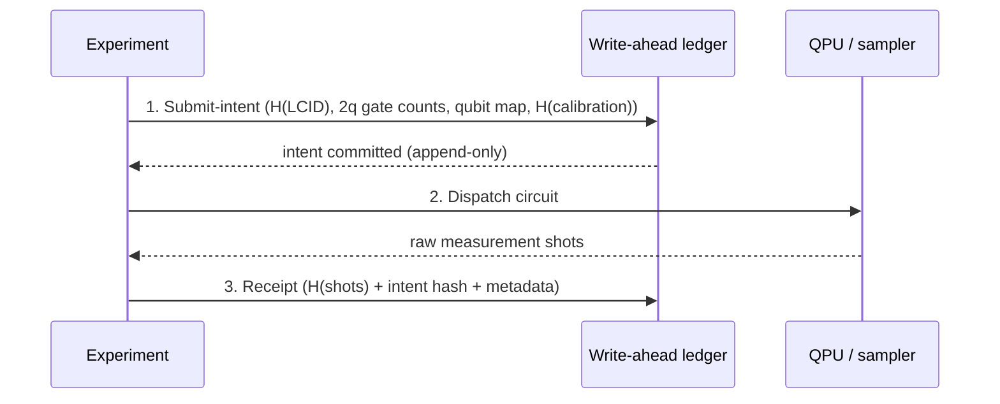
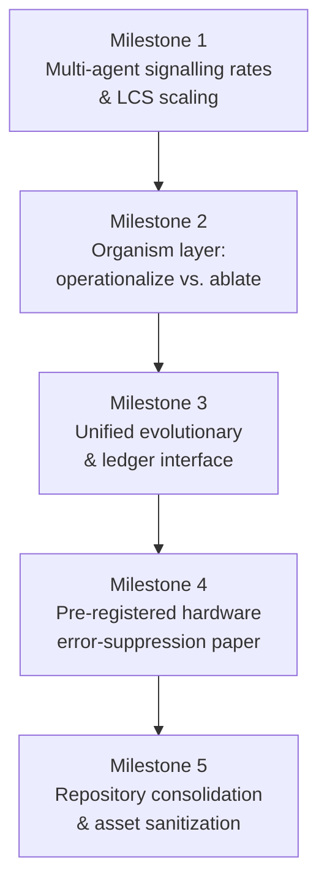
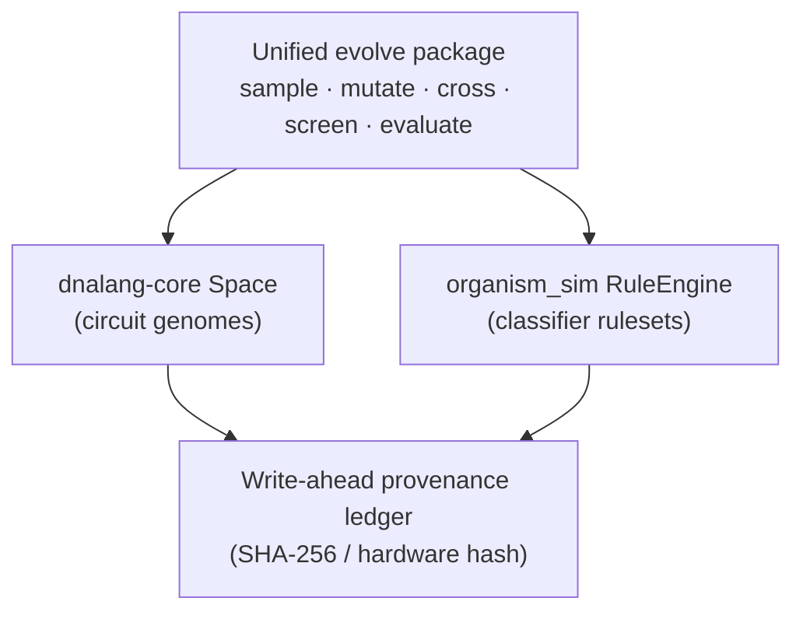
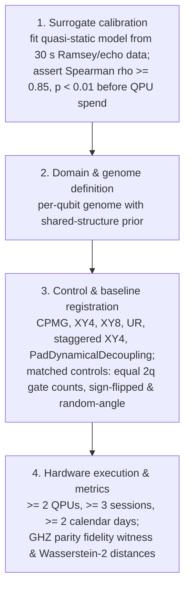
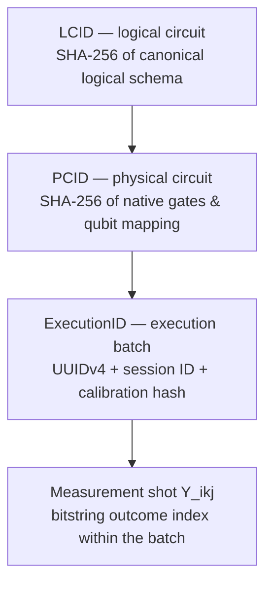

# OSIRIS

[](https://doi.org/10.5281/zenodo.23063462)

# OSIRIS

[](https://doi.org/10.5281/zenodo.23063462)
[](#versioning)
[](#install-and-run)
[](#license)

A local-first console for testing whether a small language model can learn from
conversation. OSIRIS's own model (`osiris.nclm`, the *core*) trains on every exchange and on your
documents, and may answer in its own voice only after it passes a held-out test; it has not
passed yet. Until then a local Ollama model speaks *for* it, labelled as such, and the core
trains on what it says. Models propose; deterministic code decides, measures and records.

| | |
|---|---|
| **What it is** | A governed, local-first console whose subject is a small transformer trained online on conversations with a locally hosted mentor model |
| **The rule** | Models propose; deterministic code decides, measures and records |
| **Gate status** | Speaking gate **closed** — the core has not earned its voice (see [current measured state](#current-measured-state)) |
| **Version** | 4.6.0 (see [RELEASE_NOTES_v4.6.0.md](RELEASE_NOTES_v4.6.0.md)) |
| **Author** | Devin Phillip Davis (Agile Defense Systems LLC) |
| **License** | OSIRIS Source-Available Dual License v1.0 (see `LICENSE`) — source-available, not open source |

## Contents

- [What works today (v4.6.0)](#what-works-today-v460)
- [Current measured state](#current-measured-state)
- [Install and run](#install-and-run)
- [Console command reference](#console-command-reference)
- [Evidence retrieval (olmo3-embed-7b)](#evidence-retrieval-olmo3-embed-7b)
- [Research strategy roadmap](#research-strategy-roadmap)
  - [Strategic context and codebase technical audit](#1-strategic-context--codebase-technical-audit)
  - [Theoretical intent and provenance architecture](#2-theoretical-intent--provenance-architecture)
  - [Phased execution roadmap](#3-phased-execution-roadmap)
  - [Measurement governance and pre-registered execution](#4-measurement-governance--pre-registered-execution-protocol)
- [Related, separately published work](#related-separately-published-work)
- [What this repository also contains (legacy)](#what-this-repository-also-contains)
- [Repository layout](#repository-layout)
- [Tests](#tests)
- [Versioning and release notes](#versioning)
- [Citation](#citation)

## What works today (v4.6.0)

| Part | What it does | Where |
|---|---|---|
| Conversation | Plain text talks to OSIRIS. Replies stream; keys typed during a reply are held and sent next, never mixed into the answer. | `osiris_cli/living.py` |
| Grounding | A stable brief of what is on record (pre-registered results, projects) plus per-message retrieval over your notes; answers name the file they used. | `osiris_cli/knowledge.py` |
| Read-only checks | Code, not the model, runs checks before answering — training status, git history, exchange-ledger integrity, system load, a file you name (credential files are never read). `/check` shows them directly. | `osiris_cli/probes.py` |
| Memory | Recent exchanges carry into the next session from the ledger (no model summarises them); `/remember` and `/forget` keep explicit facts. | `osiris_cli/living.py` |
| Speaking gate | The core answers in its own voice only after 30 held-out exchanges at ≤ 2.0 bits/byte and below a unigram baseline. Every 5th exchange is held out and never trained on. | `osiris_cli/living.py` |
| Batch training | `osiris train --hours 8 --detach` trains the core on a configured corpus, chat lessons and grounded distillation; distillation pauses while you chat. | `osiris_cli/train.py` |
| Provenance | Every exchange is appended to a SHA-256 hash chain (`~/.osiris/living/exchanges.jsonl`); `/check ledger` recomputes it. Since v4.6.0 an $O(1)$ tail check (`verify_chain_tail`) verifies checkpoints without re-reading the whole ledger, and full $O(N)$ sweeps are reserved for block completion and pre-flight gates. | `osiris_cli/probes.py` |
| Mentor voices | A local Ollama mentor (default `qwen2.5:7b`), plus a tri-tier gateway added in v4.5.4–v4.6.0: local `gemma2:2b` with native SSE streaming, and a `gemini-2.5-flash` compatibility provider for cloud bursting. `/mentor` switches voices on the fly (`/mentor gemini`, `/mentor gemma`, `/mentor ollama`) without a restart. | `osiris_cli/providers/` |
| Curriculum | A 1,000-interaction technical curriculum across 10 domains (`curriculum_1000.json`) with a governed block runner; Block 1 (prompts 0001–0100) executed under SYS-21 receipts, advancing the ledger to 382 entries with zero forks. | `scratch/`, `run_curriculum_1000_block.py` |
| Onboarding | `/welcome` walks new users through console commands, configuration profiles and governance concepts — it suggests commands and never runs anything without intent. | `osiris_cli/welcome.py` |

## Current measured state

The core has **not** earned its voice. After the first training runs it scored 7.60 bits/byte
on held-out documents against 5.03 for a unigram baseline — worse than the baseline. That is
the starting point the gate exists to measure honestly; the pre-registered learning test
(NCLM-1: gain over a memory-only baseline seven days after a restart) has not been run.

**Every held-out figure before v4.5.2, that one included, scored a different network from the
one trained:** scoring skipped a layer (the phase-conjugate corrector) that training applies in
every block. v4.5.2 fixes that; old gate scores no longer count until `osiris train
--rescore-only` replaces them, and whether the CRSM layers help at all is pre-registered as
NCLM-ARCH-1 (`experiments/nclm_arch1/`). See `RELEASE_NOTES_v4.5.2.md`.

## Install and run

```bash
pip install -e .                 # core; Python 3.9+
pip install -e ".[research]"     # optional: dnalang, organism_sim, bridge sibling repos
ollama pull qwen2.5:7b           # a local mentor voice (qwen2.5:1.5b on small machines)
osiris                           # start talking
```

### Optional extras

| Extra | Installs | Notes |
|---|---|---|
| `[research]` | `dnalang`, `organism_sim`, `aegis-bridge` sibling repos | The console guards every import; siblings found at `~/dnalang-core`, `~/bridge`, `~/organism_sim` are picked up automatically. Other locations: `OSIRIS_EXTRA_PATHS` (path-separated); `OSIRIS_DNALANG_LEDGER` points at dnalang-core's ledger. Installed packages always take precedence. |
| `[retrieval]` | torch, sentence-transformers | The olmo3-embed-7b evidence backend; needs Python 3.10+ (see below). |
| `[quantum]` | qiskit, qiskit-ibm-runtime, qiskit-aer | QPU dispatch and local simulation. |
| `[tui]` | textual | Terminal UI. |
| `[plot]` | matplotlib | Charts. |
| `[forge]` | trimesh, paho-mqtt, zeroconf | Fabrication / device adapters. |
| `[dev]` | pytest, pytest-cov, ruff | Test and lint tooling. |

## Console command reference

| Command | What it does |
|---|---|
| `/osiris` | Core status and speaking-gate state. |
| `/welcome` | Guided onboarding tour (suggests commands, runs nothing without intent). |
| `/check [trainer\|git\|ledger\|system]` | Deterministic read-only checks, run by code — never the model. |
| `/remember <fact>` · `/forget <words>` | Explicit long-term facts. |
| `/train [start H\|stop\|rescore]` | Control training on the core. |
| `/mentor [gemini\|gemma\|ollama]` | Show or switch the mentor voice on the fly. |
| `/self <text>` | The core's raw voice, ungated (research use). |
| `/retrieval` | Evidence-retrieval subcommands (see below). |
| `/help` | Everything else. |

From the shell: `osiris` starts the console; `osiris train …` and `osiris retrieval …` run the batch trainer and evidence backend directly.

## Evidence retrieval (olmo3-embed-7b)

`/retrieval` (or `osiris retrieval ...` from the shell) ranks scientific abstracts as evidence
candidates for a claim, using the embedding model
[petegordon/olmo3-embed-7b](https://huggingface.co/petegordon/olmo3-embed-7b) over BEIR SciFact.
It supplies ranked evidence and records how it got it. It does not decide whether a claim is
true, and it writes nothing to the claims register, facts, notes or training data.

```bash
pip install -e ".[retrieval]"                  # torch, sentence-transformers; Python 3.10+
osiris retrieval status                        # libraries, hardware policy, dataset, caches, ledger
osiris retrieval load-scifact                  # mteb/scifact at the revision mteb pins (needs huggingface.co)
osiris retrieval run --queries 25              # 25 seeded-random test claims (the CPU default)
osiris retrieval evaluate                      # nDCG@10, MRR@10, Recall@10 vs the model card
osiris retrieval capsule scifact_olmo3_embed.evidence.zip
osiris retrieval verify scifact_olmo3_embed.evidence.zip
osiris retrieval query "statins lower the risk of heart attack"
```

- **Same setup as the model card's 79.47 nDCG@10.** Queries get MTEB's SciFact instruction
  (`Instruct: Given a scientific claim, retrieve documents that support or refute the
  claim\nQuery: `). Documents get no instruction and are formatted as `title + " " + text`.
  The model runs in bf16 with a 512-token cut. Only the 300 judged test queries are scored;
  `queries.jsonl` also holds the train claims.
- **Pilot first.** `evaluate` reports the standard error and a 95% interval. It calls a run
  comparable with the card only for all 300 queries, the full 5,183-document corpus and the
  card's model, prompt and dtype. A pilot samples queries at random (seeded) by default:
  the lowest ids are the claims that start with digits. SciFact is in-domain for this model
  (its train qrels were training data), so 79.47 is not a zero-shot figure.
- **Hardware policy.** The 7B model is off on Termux/Android unless you set
  `OSIRIS_RETRIEVAL_ALLOW_EDGE=1`. Without a GPU it runs in pilot mode: 25 queries unless you
  pass `--full`, batch size 2, and it needs about 16 GiB of free RAM (`--force` overrides).
  Embedding the corpus on a CPU takes hours. The embeddings are cached in chunks and an
  interrupted build resumes. Precomputed document vectors do not make the model usable on a
  phone, because every query must be embedded by the same model. There, use a small model
  with `--model` and its own `--query-prompt`.
- **Evidence.** Each query writes a row to the hash-chained ledger
  (`~/.osiris/retrieval/ledger.jsonl`). A row holds the model revision, the instruction's
  SHA-256, the ranked doc ids, the scores and the latency; free-text queries are stored as
  hashes. A capsule holds the config, queries, qrels, rankings, metrics, the run's ledger
  rows and a summary. `verify` recomputes the digests, the metrics and the chain. Capsules
  are unsigned: verification shows internal consistency, not authorship.
- **Status.** The code path is tested with a tiny random-weight Olmo3 model of the same
  layout. No score with the real weights has been recorded in this repository yet.
  `OSIRIS_TEST_OLMO3_EMBED=1 pytest tests/test_olmo_retrieval.py` runs the real-weight tests.

## Research strategy roadmap

*Validating Learning Classifier Systems and Quantum Error Suppression on Physical QPUs.*

This section is the working research plan behind the console and its sibling repos. Its
procedural rule applies to everything above it as well:

> **No number gets a name until a histogram produced it, and no AI-written summary
> substitutes for opening the counts.**

### 1. Strategic context & codebase technical audit

The execution of rigorous forensic code audits and hardware probes marks a decisive transition
in research strategy: shifting away from historical speculative software claims toward
empirically verified computational components. Prior architectural assertions regarding broad
physics abstractions have been systematically audited, yielding a lean, fully functional, and
auditable software core across the primary repository packages.

#### 1.1 Verified core inventory assessment

| Component package | Key submodule / file | Verified behavior & key metrics | Empirical status / limitations |
|---|---|---|---|
| `organism_sim` | `lcs.py` | Textbook XCS (Wilson 1995; Butz & Wilson 2002): match sets, covering per action, fitness-weighted prediction arrays, Widrow-Hoff updates, accuracy $\kappa$, niche GA with two-point crossover, Kovacs deletion, bucket brigade with discount factor $\gamma$. Includes a Roth-Erev reinforcement mode. | Solves 6-multiplexer to 100% exploit accuracy within ~2,000 trials across 6/6 seeds; compacts macro-population from 130 to 50 rules. |
| `organism_sim` | `rules.py` | Closed s-expression action language (`emit`, `set`, `send`, `sever`, `route`, `adjust`, `if`, `seq`) governed by an 8-operator set, static validator, and tree-walking interpreter. | Operates under a strict step budget with no I/O or eval primitives; fully sandboxed and safe. |
| `organism_sim` | `bus.py` | `RoutedBus`: directed routing, tick-ordered message queues, typed payloads (signal, result, credit, state), line severing, drop accounting, JSON descriptions. | Verified in-process deque execution. |
| `organism_sim` | `agent.py` | `LCSAgent` binding rule engines to agent registers (input bits ⊕ last received symbol); implements cross-agent credit assignment. | When Agent B receives a reward, it forwards credit to the agent whose symbol was consumed, closing the bucket brigade across the bus. |
| `organism_sim` | `benchmarks/mux.py` | Split 6-multiplexer environment: Agent A sees 2 address bits (can only send 1 of 4 symbols); Agent B sees 4 data bits plus the symbol. | Isolated Agent B caps at 0.69–0.75 accuracy (majority ceiling). Paired with a fixed protocol sender, Agent B reaches 1.00 accuracy on tested seeds. |
| `dnalang-core` | `lexer.py`, `parser.py`, `sema.py` | Hand-written recursive-descent compiler for domain-specific circuit families. Validates typed gene parameters, duration units (16 µs), formal qubit ports, constant folding, and static physics invariants. | Includes a static dd-parity check: warns if a gene has an odd echo count per port, preventing uncompensated net Pauli action prior to dispatch. |
| `dnalang-core` | `lower.py`, `qc_ir.py` | Canonical lowering engine compiling abstract specifications to flat IR; exports to Qiskit and OpenQASM 3 (delays in dt or ns); generates canonical circuit hashes. | Deterministic lowering path; verified on Bell-state execution (961/1039 on Aer) and `dd_staggered_xy4.dna` (82 ops, zero diagnostics). |
| `dnalang-core` | `backends/ibm.py`, `ledger.py` | Direct backend interface executing single-qubit/two-qubit configurations without transpiler re-mapping. | Write-ahead provenance ledger logs submit-intent hashes prior to execution. |
| `dnalang-core` | `metrics/core.py` | Exact GHZ parity fidelity $F = \tfrac{1}{2}(P_{\text{pop}} + C)$ using DFT parity amplitudes. | Validated benchmark metric for entangled multi-qubit states. |
| `dnalang-core` | `evolve/` | DDSpace compiler integration; quasi-static statevector surrogate modeling detuning, ZZ crosstalk, and amplitude errors. | Surrogate ordering (`xy4_stag` > `xy4` ≈ `cpmg` ≈ `none`) matches physical hardware trends (ibm_fez), though absolute magnitudes differ due to unmodeled $T_2$ dynamics. |
| `osiris.nclm` | `autograd.py` | Pure-NumPy, tape-based reverse-mode automatic differentiation engine in float32. | Gradient-checked across matrix multiplication, GELU, softmax and cross-entropy within $2 \times 10^{-4}$ relative error. |
| `osiris.nclm` | `transformer.py` | 2-layer, 18,000-parameter sequence transformer with custom training and optimization loops. | Validated convergence: loss drops from 3.45 to 0.008 in 60 steps on repeating-sequence tasks (69/69 tests passing). |
| `osiris.nclm` | `osiris_cognitive_mesh.py` | Textbook Monte-Carlo permutation-sampling Shapley-value estimator over a coalition quality function. | Functionally verified game-theoretic valuation component; sensitivity depends entirely on the accuracy of the underlying heuristic quality function. |
| Provenance infra | Write-ahead ledger | Multi-implementation audit infrastructure (`dnalang/ledger.py`, `organism_sim/audit.py` with HMAC, `osiris/compiler/dna_ledger.py`). | Cryptographic intent-logging mechanism retained as the primary provenance standard. |

Independent empirical probes beyond automated test suites revealed key dynamics not previously
captured:

1. **Multi-agent co-adaptation rates.** In a from-scratch co-adaptation setup where both Agent A
   and Agent B learn simultaneously without a fixed protocol, 1 out of 6 random seeds converges
   to an optimal 4-symbol signalling system (1.00 accuracy). The remaining 5 seeds settle into
   partial pooling states (2–3 symbols, 0.72–0.88 accuracy). This reflects established
   reinforcement-learning dynamics in Lewis signalling games, and dictates that multi-agent
   performance must be evaluated as a statistical convergence rate across seed distributions
   rather than a single-seed success metric.
2. **Organism layer ablation.** Comparative ablation of the Learning Classifier System with
   structural repair/mutation enabled (`structural=True`) against plain LCS execution
   (`structural=False`) demonstrated identical 6-multiplexer accuracy (1.00 across 4/4 seeds).
   This confirms that the top-level organism repair, phase coupling and mutation triggers
   currently perform zero computational work in solving the task; the underlying LCS engine
   performs the entirety of the optimization.

These findings establish the baseline for an operational autopsy of legacy software failure
modes.

#### 1.2 Diagnostic autopsy of legacy artifacts & procedural invariants

A thorough technical autopsy of historical failure modes is mandatory to establish future
engineering controls and prevent the resurgence of ungrounded scientific claims. Forensic
review reveals that prior high-impact claims stemmed from unvalidated instrumentation,
uncorrected software defects, and premature physics nomenclature:

- **Deconstruction of historical record claims.** Investigation of the $10^6\times$ gain
  artifact revealed that the reported 0.3843 "noise floor" was mathematically identical to
  $\cos^2(51.7^\circ)$ — the exact ideal theoretical population of the target state at the
  evaluated rotation angle $\theta = 51.7^\circ$. Rather than reflecting physical hardware
  decoherence suppression, hardcoded metrics were written into static JSON files. Physical
  re-execution of these circuit patterns on `ibm_kingston` yielded a classical state fidelity
  of 0.050, demonstrating that the physical $\theta = 51.7^\circ$ rotation was statistically
  indistinguishable from zero rotation ($\theta = 0$), while transpiler routing generated 166
  CX gates where 39 were sufficient.
- **Deconstruction of pseudo-physics terminology.** Physics-named code abstractions in the
  legacy `osiris` module demonstrated functional disconnects between nomenclature and
  computation:
  - "Pilot-wave attention" was implemented as a static scalar score multiplier
    $1 + e^{-|i-j|/T}$.
  - "Golden scale" was a constant multiplication factor (0.618) applied to FFN outputs,
    trivially absorbed by subsequent weight matrices.
  - "Phase-conjugate positional encoding" was a sinusoidal positional encoding using base
    $\phi \approx 1.618$ instead of $10^4$. Whereas standard positional encoding spans four
    orders of magnitude to prevent positional aliasing across sequence lengths, base-$\phi$
    encoding restricted spectral representation to a narrow window of $[0.38, 1]$ rad/position,
    forcing severe frequency aliasing — a fundamental mathematical defect.
- **Decoder architectural defects.** The decoder module `osiris/decoders/tesseract.py`
  calculated residual syndromes via elementwise bitwise XOR:
  $\text{syndrome}_{\text{residual}} = \text{syndrome} \oplus \text{correction}$. Standard QEC
  decoders map data-qubit corrections through a parity-check matrix $H$. Treating syndrome
  bits and correction bits as identical structural objects invalidated the module as a
  functional QEC decoder.

To permanently prevent the recurrence of these software and experimental failure modes, all
operations within this roadmap are strictly governed by a non-negotiable procedural invariant:

> **Procedural Governing Rule:** No number gets a name until a histogram produced it, and no
> AI-written summary substitutes for opening the counts.

### 2. Theoretical intent & provenance architecture

#### 2.1 The unified evolutionary & reinforcement loop

Stripping away non-functional nomenclature clarifies the core compute function of the
substrate. The platform is formally defined as: an evolutionary and reinforcement learning
architecture operating over populations of rule-based agents and quantum circuit space,
evaluated via physical or simulated fitness metrics, passing messages over structured buses,
and cryptographically verified through write-ahead provenance ledgers.

The unified, canonical execution loop governing both multi-agent reinforcement and quantum
control-sequence optimization:


Strict operational boundaries define the validated limits of this architecture:

- **Verified scope:** local multi-agent message passing via `RoutedBus` within a single process
  memory space, featuring cross-agent credit assignment and deterministic execution ticks.
- **Unverified scope:** assertions of "decentralized edge swarms," "fault-tolerant distributed
  infrastructure," or "resilient mesh routing" represent category errors when applied to an
  in-process, single-memory-space deque (`RoutedBus`). No code exists in the repository to
  handle multi-machine network transport, node failure recovery, or network partition
  tolerance. These unverified claims are formally excluded from active operational scope.

#### 2.2 Tamper-evident provenance & write-ahead ledger mechanics

To guarantee scientific validity and eliminate post-hoc data selection, all experimental
executions on physical QPUs or agent simulations must pass through a write-ahead cryptographic
ledger (`backends/ibm.py` and `organism_sim/audit.py`):



1. **Pre-execution submit-intent entry.** Prior to dispatching a job to the hardware execution
   queue (e.g. via Qiskit `SamplerV2.run`), the environment constructs a canonical
   submit-intent record: the UTF-8 SHA-256 hash of the logical circuit representation,
   explicit 2-qubit gate counts, target physical qubit mappings, and a complete SHA-256 hash
   of the target QPU's immediate calibration table. This intent is committed to append-only
   storage *before* job submission.
2. **Hardware dispatch.** The circuit payload is submitted to the target QPU backend or
   simulation surrogate.
3. **Post-execution receipt.** Upon job completion, the raw, unedited measurement shot
   counts, output bitstrings, and execution metadata are logged alongside the pre-execution
   submit-intent hash, generating a closed provenance block.

Under the cryptographic security of SHA-256 collision resistance, this sequence prevents
post-hoc circuit filtering, selective data omission, or metric alteration after hardware
execution. Establishing this tamper-evident cryptographic chain is the operational
prerequisite for executing the phased research roadmap.

### 3. Phased execution roadmap



#### 3.1 Milestone 1: Multi-agent signalling rates & LCS scaling

*Objective: convert single-seed communication demonstrations into statistically rigorous,
multi-seed convergence profiles.*

- **Statistical rate protocol.** Run multi-agent co-adaptation benchmarks across 50
  independent random seeds. Report the probability of achieving full 4-symbol signalling
  $P(\text{full})$, the probability of settling into partial pooling $P(\text{partial})$, and
  mean population accuracy with 95% bootstrap confidence intervals. Package unit tests must
  assert rate-distribution bounds rather than single-seed outcomes.
- **Algorithmic interventions.** Implement and evaluate two communication recovery mechanisms
  to mitigate sub-optimal pooling equilibria:
  1. Forgetting parameters in Roth-Erev reinforcement (`reinforce_decay < 1.0`).
  2. Explicit niche exploration scheduling within the XCS engine.
  - *Target metric:* a statistically significant increase in $P(\text{full})$ from ~0.17 to
    > 0.80.
- **Scaling & topology expansion.** Benchmark the core `lcs.py` engine against standard
  11-multiplexer and 20-multiplexer environments to confirm scalability. Extend the message bus
  to a 3-agent linear topology (Address Agent → Relay Agent → Data Agent) to test multi-hop
  credit backpropagation across intermediate nodes — reward signals must propagate transitively
  via forwarded credit payloads, not direct single-step feedback.

#### 3.2 Milestone 2: Organism layer operationalization vs. ablation

*Architectural abstractions must demonstrate clear computational utility under experimental
stress testing; components that do not alter physical measurements must be removed.*

- **Non-stationary environment design.** Construct a dynamic 6-multiplexer benchmark where the
  underlying address-bit mapping is permuted every N trials (e.g. flipping address bit indices
  at N = 5,000).
- **Comparative ablation metrics.** Measure fitness-loss recovery rates and re-adaptation
  latency post-permutation across three configurations:
  1. Standard baseline LCS (`lcs.py`).
  2. LCS with structural repair driven by entropy triggers (`gp_mutate`).
  3. LCS with sever-on-pressure signaling (`sever`).
- **Decision criteria.** If structural mutation logic yields a statistically significant
  reduction in adaptation latency post-shift, retain and document the organism layer. If
  performance is statistically indistinguishable from baseline LCS, remove the organism
  abstraction layer from the active codebase entirely.

#### 3.3 Milestone 3: Unified evolutionary & ledger interface

*Optimization procedures across quantum circuit compilation and classifier learning must be
consolidated into a single unified architecture.*



- **Unified core package.** Construct a unified `evolve` module unifying dnalang-core's
  `Space` protocol and organism_sim's `RuleEngine` under a common object-oriented interface:
  - `Sample()` — draw candidate specifications from search spaces.
  - `Mutate()` — apply domain-specific mutation operators.
  - `Cross()` — perform crossover across parent candidate specifications.
  - `Screen()` — apply static invariant filters (e.g. static dd-parity checks).
  - `Evaluate()` — fitness evaluation via surrogate models, physical QPUs, or multi-agent
    environments.
- **Embedded ledger integration.** Position the write-ahead cryptographic ledger directly
  underneath the `evolve` interface. Every evaluation automatically generates a
  cryptographically chained block containing the input genome, chosen evaluator, raw
  measurement output, and fitness score.

#### 3.4 Milestone 4: Pre-registered hardware error-suppression paper

*Goal: execute and publish a publication-grade error-suppression experiment on physical IBM
Quantum QPUs (~30 minutes total QPU allocation).*



1. **Surrogate calibration.** Fit a quasi-static statevector surrogate model using empirical
   device calibration data (30 seconds of Ramsey/echo pulse sequences per qubit chain). Validate
   predictive capability by asserting a statistically significant Spearman rank correlation
   ($\rho \ge 0.85$, $p < 0.01$) between surrogate predictions and physical QPU sequence
   rankings **prior to expending hardware execution time**.
2. **Genome & domain architecture.** Implement a per-qubit sequence genome incorporating a
   shared-structure prior to systematically target and mitigate $T_2$ outlier channels across
   multi-qubit registers.
3. **Pre-registered controls & baselines.** Evaluate candidate dynamically decoupled sequences
   against standard baselines: CPMG, XY4, XY8, UR, staggered XY4, and PadDynamicalDecoupling.
   All comparative test circuits must maintain identical 2-qubit gate counts, matched idle
   durations, sign-flipped controls, and randomized angle controls.
4. **Replication & target metrics.** Execute pre-registered experimental runs across ≥ 2
   distinct physical QPU backends, acquiring ≥ 3 independent session replicates over ≥ 2
   calendar days. Quantify error suppression using GHZ parity fidelity witnesses
   $F = \tfrac{1}{2}(P_{\text{pop}} + C)$ and Wasserstein-2 ($W_2$) distribution distances
   with 95% bootstrap confidence intervals.

#### 3.5 Milestone 5: Repository consolidation & asset sanitization

*Consolidate repository fragmentation into a clean, auditable repository structure.*

- **Target architecture.** Consolidate 172 fragmented legacy repositories down to two
  production-grade repositories:
  1. `dnalang` — compiler, QPU execution pipeline, hardware surrogate models, and evolutionary
     sequence optimization.
  2. `organism_sim` — LCS engine, multi-agent bus, cross-agent credit assignment, and
     communication benchmarks.
- **Documentation sanitization.** Update primary repository READMEs to state strictly verified
  operational behavior and raw measurement counts.
- **Archival & errata management.** Formally archive all remaining historical repositories,
  embedding clear pointers to the public Zenodo errata bundle (`dnalang/zenodo_v2_bundle/`).

### 4. Measurement governance & pre-registered execution protocol

#### 4.1 Data & execution hierarchy specifications

To prevent ambiguity between logical program code, hardware job dispatch, and physical
measurement instances, all experiments adhere to a strict four-level identity hierarchy:

| Level | Definition | Identity determinant | Mutability / scope |
|---|---|---|---|
| **Logical Circuit (LCID)** | Pre-specified computational experiment defining target gates, state preparations, and measurement operators. | Canonical UTF-8 SHA-256 hash of standardized JSON circuit schema. | Immutable. Global logical scope; constant across backend executions. |
| **Physical Circuit (PCID)** | Transpiled/compiled physical execution specification mapped to explicit hardware qubit layouts and native gate sets. | Canonical UTF-8 SHA-256 hash of compiled physical gate-sequence schema. | Immutable. Backend-specific scope; changes if layout or routing varies. |
| **Execution Batch (ExecutionID)** | A single physical execution batch of a PCID acquired under a specific calibration state and execution timestamp. | Unique UUIDv4 identifier linked to hardware session ID and calibration hash. | Immutable post-acquisition. Instance-level scope. |
| **Measurement Shot** | Individual measurement-outcome bitstring generated during an execution batch ($Y_{ikj}$). | Array index position $j$ within the raw measurement array of an ExecutionID. | Immutable raw data. Nested strictly within an ExecutionID. |



**Physical replication rule.** Individual measurement shots ($N_{\text{shots}}$) estimate the
outcome distribution for a single execution batch; shots are **not** independent physical
replicates. True physical replication occurs only across independent hardware execution batches
(ExecutionID), separate calibration cycles, distinct operational sessions, and multiple QPU
backends.

#### 4.2 Primary statistical estimand & matched-pair analysis

Confirmatory testing of quantum error-suppression interventions requires pre-registered causal
estimands and matched-pair statistical contrasts.

**Primary causal estimand ($\Delta F$).** The population-level mean fidelity contrast between
the pre-registered test condition ($T$) and the matched control condition ($C$) across target
circuit trials:

$$\Delta F = E[F_i \mid C_i = T] - E[F_i \mid C_i = C]$$

**Matched-pair estimator.** For $K$ matched circuit pairs sharing identical logical depth,
2-qubit gate counts, target states, and physical qubit allocations, the pair-level difference
$D_k$ and overall sample estimator are:

$$D_k = F_{k,T} - F_{k,C}, \qquad \widehat{\Delta F} = \frac{1}{K}\sum_{k=1}^{K}\left(F_{k,T} - F_{k,C}\right)$$

**Hierarchical mixed-effects model.** Multi-backend and multi-session physical hardware
acquisitions are analyzed using a pre-registered hierarchical linear mixed-effects model:

$$F_{ik} = \beta_0 + \beta_1 C_i + u_{\text{backend}} + u_{\text{circuit}} + \epsilon_{ik}$$

where $i$ indexes the circuit trial instance, $k$ indexes the matched pair or execution
session, $C_i \in \{0, 1\}$ is the binary condition indicator (0 = control, 1 = test), and
$u_{\text{backend}} \sim \mathcal{N}(0, \sigma^2_{\text{backend}})$ and
$u_{\text{circuit}} \sim \mathcal{N}(0, \sigma^2_{\text{circuit}})$ are random intercepts for
hardware-device and circuit-topology variance respectively. The fixed-effect coefficient
$\beta_1 = \Delta F$ defines the population-level intervention effect.

**Falsification criteria.** The proposed error-suppression intervention $T$ is formally declared
**falsified** if any of the following occur:

1. The 95% bootstrap confidence interval for $\widehat{\Delta F}$ overlaps zero
   ($\Delta F \le 0$).
2. Conventional decoherence models (e.g. standard CPMG/XY4 dynamical decoupling) match or
   exceed the candidate intervention's fidelity out-of-sample.
3. The observed fidelity improvements vanish when evaluated against independently constructed
   calibration-state tables.

Adherence to this pre-registered execution and provenance framework guarantees
publication-grade scientific validity.

## Related, separately published work

- **organism_sim / dnalang-core / bridge** — pre-registered ALife and dynamical-decoupling
  experiments with a checked-in scorecard (PASS and FAIL recorded alike).
  Zenodo [10.5281/zenodo.22862567](https://doi.org/10.5281/zenodo.22862567).
- **Staggered dynamical decoupling on ibm_marrakesh** — a pre-registered run in which
  bipartite-staggered DD kept P(+) = 0.900 at 32 µs versus 0.834 for simultaneous DD and 0.595
  idle (non-overlapping 95% CIs; job `dau0q3qhcrkc73durtgg`; data in
  `experiments/osiris_advantage_marrakesh/`;
  Zenodo [10.5281/zenodo.23045494](https://doi.org/10.5281/zenodo.23045494)).
- **The Quantum Ultimatum: Engineering Spacetime with DNA-Lang** — Devin Phillip Davis,
  IBM Community Research & Technical Discussions. Available at:
  [community.ibm.com/community/user/discussion/the-quantum-ultimatum-engineering-spacetime-with-dna-lang](https://community.ibm.com/community/user/discussion/the-quantum-ultimatum-engineering-spacetime-with-dna-lang).

## What this repository also contains

The `osiris/` package and many root-level `osiris_*.py` modules come from earlier phases of the
project (the CRSM framework, qByte simulator, agent constellation, dna::}{::lang compiler v1).
Several of their headline constants and metrics — the τ-phase anomaly, θ_lock = 51.843°, the
CCCE "consciousness" metrics — were tested on hardware by the author and **refuted**; the code
is kept for provenance and still runs, but those quantities are not presented as physics.
The previous README is preserved at `docs/README_v4_legacy.md`.

## Repository layout

| Path | What it is |
|---|---|
| `osiris_cli/` | The governed console: REPL, living conversation loop, mentor providers, probes, training, retrieval. |
| `osiris/`, `osiris_*.py` | Legacy-phase modules (kept for provenance; see above). |
| `nclm/`, `osiris.nclm` | The core transformer and its research line (NCLM). |
| `rqc/` | Randomized quantum circuit tooling: S2 batched harness, samplers, Willow QVM interop, budget gates. |
| `experiments/` | Pre-registered experiment bundles with raw artifacts and ledgers (e.g. `osiris_advantage_marrakesh/`, `nclm_arch1/`). |
| `bench_tasks/` | Benchmark task definitions consumed as data by the console and `osiris_bench`. |
| `curriculum/`, `scratch/` | The 1,000-interaction technical curriculum and its block runner. |
| `governance/`, `docs/` | Governance records and documentation (incl. `README_v4_legacy.md`). |
| `tests/` | The test suite (`pytest`). |
| `RELEASE_NOTES_*.md` | Per-release notes, v3.0 through v4.6.0. |

## Tests

```bash
pip install -e ".[dev]"
pytest tests/
```

The v4.5.4 release notes report the full suite on Python 3.12 as **871 passed, 3 skipped**.

## Versioning

Releases are versioned as `vMAJOR.MINOR.PATCH` with notes checked in per release:
[RELEASE_NOTES_v4.5.2.md](RELEASE_NOTES_v4.5.2.md) (scoring fix + NCLM-ARCH-1 pre-registration) ·
[RELEASE_NOTES_v4.5.3.md](RELEASE_NOTES_v4.5.3.md) (ledger fork-prevention under lock) ·
[RELEASE_NOTES_v4.5.4.md](RELEASE_NOTES_v4.5.4.md) (sovereign REPL contract, dual-substrate
node detection, RQC S2 multi-PUB batching, `/welcome`) ·
[RELEASE_NOTES_v4.6.0.md](RELEASE_NOTES_v4.6.0.md) (tri-tier mentor gateway, O(1) ledger tail
verification, 2,048-token mentor budget, 1,000-interaction curriculum). Earlier releases:
v3.0 → v4.5.1 notes live at the repo root alongside them.

## Citation

If you use OSIRIS in your research, cite the archived software release:

```bibtex
@software{osiris_cli,
  author  = {Davis, Devin Phillip},
  title   = {OSIRIS: a governed local console for a living language model},
  year    = {2026},
  version = {4.6.0},
  doi     = {10.5281/zenodo.23063462},
  url     = {https://doi.org/10.5281/zenodo.23063462}
}
```

`CITATION.cff` at the repo root carries the same metadata for GitHub's citation tooling.

## License

OSIRIS Source-Available Dual License v1.0 — source-available, not open source. See `LICENSE`.
* Deconstruction of Pseudo-Physics Terminology: Examination of physics-named code abstractions in the legacy osiris module demonstrated functional disconnects between nomenclature and computation:
  * "Pilot-wave attention" was implemented as a static scalar score multiplier: 1 + e^{-|i-j|/T}.
  * "Golden scale" consisted of a constant multiplication factor (0.618) applied to Feed-Forward Network (FFN) outputs, which was trivially absorbed by subsequent weight matrices.
  * "Phase-conjugate positional encoding" was a sinusoidal positional encoding using base \phi \approx 1.618 instead of 10^4. Whereas standard positional encoding spans four orders of magnitude to prevent positional aliasing across sequence lengths, base-\phi encoding restricted spectral representation to a narrow window of [0.38, 1]\text{ rad/position}, forcing severe frequency aliasing and creating a fundamental mathematical defect.
* Decoder Architectural Defects: The decoder module osiris/decoders/tesseract.py calculated residual syndromes via elementwise Bitwise XOR: \text{syndrome}_{\text{residual}} = \text{syndrome} \oplus \text{correction}. Standard Quantum Error Correction (QEC) decoders map data-qubit corrections through a parity-check matrix H. Treating syndrome bits and correction bits as identical structural objects invalidated the module as a functional QEC decoder.

```bash
python -m pip install -e .
```

Optional feature sets are available:

```bash
python -m pip install -e '.[tui]'
python -m pip install -e '.[quantum]'
python -m pip install -e '.[plot]'
python -m pip install -e '.[forge]'
python -m pip install -e '.[retrieval]'
```

Run the console:

```bash
osiris
```

Or invoke the package directly:

```bash
python -m osiris_cli
```

## High-level architecture

The repository has a few major layers:

### 1. Console and orchestration

The main runtime lives in `osiris_cli/` and includes modules for:

- REPL behavior and command orchestration
- knowledge access and retrieval metadata
- living system state and recordkeeping
- provider/gateway integrations
- training and learning loops

The console entry point is declared in `pyproject.toml`:

```toml
[project.scripts]
osiris = "osiris_cli.osiris_repl:main"
```

### 2. Language-model and learning pipeline

The project includes a local, continuously learning model stack and infrastructure for gating model voice or output. The design emphasizes local execution, structured memory, and governance over unverified claims.

### 3. Provenance and evidence infrastructure

The repo contains a significant amount of code and documentation about write-ahead ledgers, hash chaining, and measured execution logs. This is a key design principle: evidence is captured before and after execution, and recorded with enough structure to support later audit.

### 4. Quantum and hardware research tooling

In addition to the CLI, OSIRIS includes protocols and tooling for:

- IBM QPU job analysis
- benchmark generation and reporting
- dynamical-decoupling studies
- anomaly detection and research notebooks/scripts
- quantum-discovery project scaffolding

## Repository layout

A representative view of the project structure:

- `README.md` — project overview and entry point
- `pyproject.toml` — packaging metadata and optional dependency groups
- `osiris_cli/` — primary console and runtime modules
- `tests/` — repository test suite
- `quantum_discovery/` — research framework for discovery-oriented analysis
- `experiments/` — execution and experiment folders
- `bench_tasks/` — benchmark task definitions
- `docs/` and top-level research markdown files — design notes, evidence, audit docs, and operational summaries

Notable files:

- `LICENSE`
- `pyproject.toml`
- `osiris_cli/osiris_repl.py`
- `osiris_cli/knowledge.py`
- `quantum_discovery/README.md`
- `experiments/`

## Quick start examples

### Start the CLI

```bash
osiris
```

### Install with TUI support

```bash
python -m pip install -e '.[tui]'
```

### Install for quantum research workflows

```bash
python -m pip install -e '.[quantum,tui,plot]'
```

## Research and evidence posture

The repo makes an explicit distinction between:

- local-first model development
- empirical evidence collection
- provenance and auditability
- research exploration versus production readiness

The codebase and docs stress measured behavior, reproducibility, and recorded evidence. This is stronger than a generic model wrapper; it is oriented around evaluating whether the system learns under controlled conditions and whether the observations are auditable.

## Tests

The repository includes a Python test suite under `tests/` and is configured with pytest in `pyproject.toml`.

Typical usage:

```bash
pytest -o cache_dir=/tmp/osiris_pytest_cache tests/
```

## Key design principles

- local-first execution
- explicit governance of model voice and output
- audit-friendly record keeping
- measured evaluation instead of narrative-only claims
- experimentation that can coexist with a production CLI shell

## Notable project themes

The repo repeatedly touches these themes:

| Part | What it does | Where |
|---|---|---|
| Conversation | Plain text talks to OSIRIS. Replies stream; keys typed during a reply are held and sent next, never mixed into the answer. | `osiris_cli/living.py` |
| Grounding | A stable brief of what is on record (pre-registered results, projects) plus per-message retrieval over your notes; answers name the file they used. | `osiris_cli/knowledge.py` |
| Read-only checks | Code, not the model, runs checks before answering — training status, git history, exchange-ledger integrity, system load, a file you name (credential files are never read). `/check` shows them directly. | `osiris_cli/probes.py` |
| Memory | Recent exchanges carry into the next session from the ledger (no model summarises them); `/remember` and `/forget` keep explicit facts. | `osiris_cli/living.py` |
| Speaking gate | The core answers in its own voice only after 30 held-out exchanges at ≤ 2.0 bits/byte and below a unigram baseline, both scored on every byte of the reply. Every 5th exchange is held out and never trained on. | `osiris_cli/living.py` |
| Probe set | About 100 held-out replies, frozen once, scored whole at every 1,000-step milestone checkpoint, so learning can be told apart from a change of topic. `/train probe` scores new milestones; `/train probe freeze` draws the set. | `osiris_cli/probeset.py` |
| Batch training | `osiris train --hours 8 --detach` trains the core on a configured corpus, chat lessons and grounded distillation; distillation pauses while you chat. | `osiris_cli/train.py` |
| Provenance | Every exchange is appended to a SHA-256 hash chain (`~/.osiris/living/exchanges.jsonl`); `/check ledger` recomputes it. | `osiris_cli/probes.py` |

## License and provenance

This repository is source-available under the OSIRIS Dual License v1.0. The project also includes a research record and provenance-oriented documentation intended to support evidence review and scientific traceability.

## Summary

**Until scorer 3 (2026-10-27) the gate read only the opening of each held-out reply:** the core
was scored on the first two 128-byte windows (~254 bytes, mostly the mentor's formulaic opening)
while the unigram baseline was scored on the whole reply. Amendment 4's fix (`4e42bc90`) had never
reached `main`. Both are now scored on every byte the core predicts. On the live core's last 30
held-out replies (step 9250) the whole reply gives 3.20 bits/byte where the first two windows gave
2.90. Scorer-2 scores no longer count; `osiris train --rescore-only` replaces them and first keeps a
copy of `stats.json`, whose scores trace the core's learning one exchange at a time.

## Install and run

- local model operation
- training and learning loops
- governance and evaluation gates
- provenance-aware records
- quantum and hardware analysis tooling

That combination makes it a useful project for reproducible, evidence-anchored experimentation in AI and quantum-adjacent research.

## Repository composition

The GitHub repository composition is roughly:

- Python: 96.6%
- TeX: 1.2%
- Shell: 0.9%
- OpenQASM: 0.7%
- Jupyter Notebook: 0.3%
- Cython: 0.2%
- C: 0.1%

## Related documentation

A few useful starting points in this repo include:

- `README.md`
- `pyproject.toml`
- `quantum_discovery/README.md`
- `osiris_cli/knowledge.py`
- `osiris_cli/osiris_repl.py`
- `LICENSE`

If you want a single high-signal way to enter the project, start with the console entry point and then move into the research documents and experimental folders.
