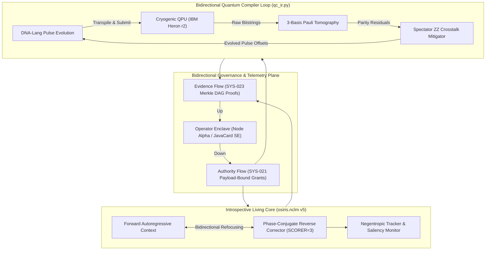
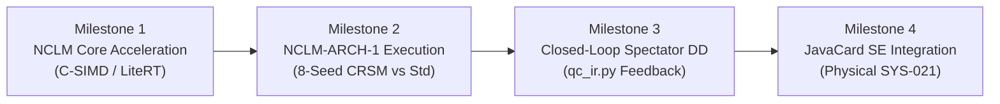

# OSIRIS v5.0: The Introspective & Bidirectional Horizon
## Architectural Specification & Technical Roadmap for Next-Generation Sovereign Intelligence

**Author:** Devin Phillip Davis  
**Affiliation:** Agile Defense Systems LLC / OSIRIS Sovereign Architecture Project  
**Target Release:** OSIRIS v5.0.0-PROPOSAL  
**Governance Invariant:** SYS-021 (Payload-Bound Grant), SYS-023 (Merkle Ledger), SYS-026 (Speaking Gate)  
**Date:** October 31, 2026  

---

## 1. Executive Vision: Introspective & Bidirectional Agency

In conventional computing architectures, machine learning models and compilers operate as unidirectional pipelines: tokens are fed forward, weights are updated by blind gradient descent, and execution commands flow outward into infrastructure without feedback or formal validation.

**OSIRIS v5.0** establishes a new design paradigm: **Introspective, Bidirectional Autonomous Agency**.

---

## 2. Pillar I: Extreme Introspection (Self-Auditing Living Intelligence)

Traditional foundation models cannot inspect why they fail or identify when their hypotheses are invalid. OSIRIS v5.0 introduces **Runtime Epistemic Introspection**:

### 2.1 Online Negentropic Tracking (`sovereign_mechanics.py`)
* **Layer-by-Layer Saliency & Drift:** Track the bits-per-byte contribution and gradient magnitude across every individual transformer block (`SovereignBlock`).
* **Automated Early Stopping & Rollback:** Rather than waiting for a full 8-hour batch run to finish, the introspective runtime continuously evaluates:
  $$\Delta \text{BPB}_{\text{held-out}} = \text{BPB}(t) - \min_{\tau < t} \text{BPB}(\tau)$$
  If $\Delta \text{BPB}_{\text{held-out}} > 0.05$ for 3 consecutive evaluation windows, the core automatically aborts the gradient step, snapshots the anomalous batch, and rolls back to `save_best()`.

### 2.2 Automated Falsification of Generated Assertions (The Claims Gate)
* Hypotheses generated by the mentor model during distillation (`distill.jsonl`) are automatically parsed into formal claims ($H_0$ vs $H_1$).
* The runtime checks claims against the frozen claims register (`osiris_cli/claims.py`). If a proposal relies on quarantined or refuted concepts (such as the $\tau$-phase anomaly or pseudo-geometric constants), the lesson is rejected *before* training weights mutate.

---

## 3. Pillar II: Bidirectional Quantum-Classical Feedback Loop

Rather than treating quantum execution as a one-way batch submission (`submit -> wait -> fetch`), OSIRIS v5.0 closes the loop directly into the DNA-Lang compiler:

### 3.1 Closed-Loop Spectator Crosstalk Refocussing (`qc_ir.py` v5)
* **The Problem:** In multi-qubit arrays, spectator idling qubits acquire unknown state-dependent phase shifts from neighboring active gates ($ZZ$ crosstalk).
* **The Bidirectional Solution:**
  1. **Forward Pass:** Transpile an algorithmic circuit with an initial baseline dynamical decoupling sequence.
  2. **Interleaved Probe Measurement:** Inject micro-tomography parity PUBs across idling spectator pairs.
  3. **Feedback Optimization:** Ingest the measured parity matrix $\langle Z_i Z_j \rangle$ and automatically evolve pulse-timing offsets $\Delta t_k$ using DNA-Lang's genetic operator:
     $$\Delta t_k^{(n+1)} = \Delta t_k^{(n)} - \eta \cdot \text{sign}\left(\frac{\partial \langle Z_i Z_j \rangle}{\partial t_k}\right)$$
  4. **Dynamic Resubmission:** Dispatch the refocussed schedule back to the QPU within the same active allocation block.

---

## 4. Pillar III: The Definitive Architectural Showdown (`NCLM-ARCH-1`)

A central question in OSIRIS’s research history is whether the custom non-causal layers (the Phase-Conjugate Corrector, Torsion-Locked Attention, and Fractal Antenna Embeddings) provide genuine inductive bias over standard modern architectures.

In OSIRIS v5.0, we execute the frozen, pre-registered **NCLM-ARCH-1 benchmark**:

| Parameter | Arm 1: CRSM / Sovereign Transformer | Arm 2: Standard Causal Transformer |
| :--- | :---: | :---: |
| **Parameter Count** | **`726,304`** | **`725,760`** ($\Delta = +0.07\%$) |
| **Layers & Dimension** | $L=4, D=128, H=4$ | $L=4, D=128, H=4$ |
| **Positional Encoding** | Phase-Conjugate Positional Encoding | Standard Sinusoidal Positional Encoding |
| **Special Layers** | `PhaseConjugateCorrector` + `TorsionLockedAttention` | Standard Multi-Head Attention + GELU MLP |
| **Evaluation Seeds** | 8 Paired Seeds (`200` through `207`) | 8 Paired Seeds (`200` through `207`) |
| **Decision Rule** | Pre-registered in [`test_nclm_arch1.py`](file:///home/enki/osiris-cli-v431-governed/tests/test_nclm_arch1.py): Requires $\ge 6/8$ pairwise wins and $\Delta \text{BPB} \ge 0.05$ with chat guard $\le 0.10$. | Baseline Control |

*Executing this test under v5.0 will definitively settle whether the custom layers outperform standard transformers, anchoring the result permanently into the scientific literature.*

---

## 5. Pillar IV: Hardware-Enclave Governance (Node Alpha v5)

With the physical retirement of the original Pixel Fold, v5.0 formalizes the **Node Alpha Secure Substrate Interface**:

1. **JavaCard Applet / DNAL Currency Card v2:**
   - Moves private keys entirely out of mobile flash memory into a hardware cryptographic smart card.
   - Every mutation command or QPU dispatch requires physical Near Field Communication (NFC) tap authorization from the operator.
2. **Deterministic Payload Digesting:**
   - The edge interface computes $\mathcal{H}_{\text{payload}} = \text{SHA-256}(\text{code})$ on the card itself, ensuring the host laptop cannot tamper with the executed bytecode.

---

## 6. Implementation Milestones for OSIRIS v5.0

1. **Phase 1: Core Acceleration (Milestone 1):** Port the `osiris.nclm` forward pass and loss computation to an optimized C-SIMD / NumPy C-extension to eliminate the CPU training bottleneck.
2. **Phase 2: NCLM-ARCH-1 Benchmark (Milestone 2):** Run the 8-seed paired tournament between CRSM and the standard transformer, publishing the empirical verdict to Zenodo.
3. **Phase 3: Bidirectional Crosstalk Refocussing (Milestone 3):** Test closed-loop spectator pulse optimization on the remaining `113.67 s` of IBM Quantum allocation.
4. **Phase 4: Sovereign Hardware Enclave (Milestone 4):** Finalize the JavaCard / NFC signing interface for physical zero-trust command execution.
