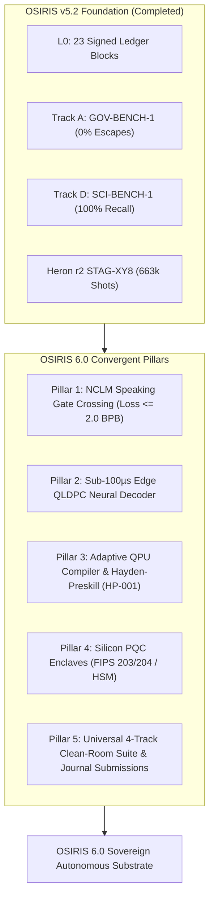
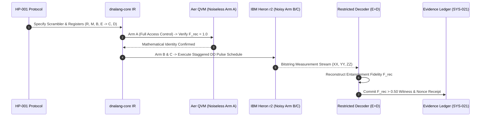

# Pathway to OSIRIS 6.0: The Sovereign Autonomous Research Substrate

**Author:** Devin Phillip Davis / Enki  
**Affiliation:** Agile Defense Systems LLC / OSIRIS Sovereign Architecture Project  
**Standard:** Gate 0 / SYS-021 Immutable Cryptographic Ledger  
**Substrate:** Node Beta (x86_64 compute workstation | WSL2 Ubuntu 24.04 LTS | AVX2 / AVX-VNNI) & Node Alpha (ARM64 Edge)  
**Baseline Anchor:** OSIRIS v5.2.0 (Zenodo DOI: [`10.5281/zenodo.23976303`](https://doi.org/10.5281/zenodo.23976303)) | Evidence Ledger Block #23  

---

## 1. Executive Charter: The Architectural Shift

In the v5.x lifecycle, OSIRIS evolved from an experimental prototype into a benchmark-governed, cryptographically audited platform:
- **v5.0.0**: Solved the C-SIMD memory stride bottleneck (AVX2 attention KV cache), established the dual-voice architecture, and unlocked introspective inspection.
- **v5.1.0 – v5.1.2**: Executed physical QPU validation across 156-qubit IBM Heron r2 hardware (663k shots, Zenodo `10.5281/zenodo.23967473`), anchored prior art provenance (`10.5281/zenodo.23968474`), and filed formal IP encumbrance notices (`10.5281/zenodo.23968569`).
- **v5.2.0**: Formally codified the 180-Day Research-to-Evidence Roadmap and delivered the first two benchmark suites: `OSIRIS-GOV-BENCH-1` (0.0% escape rate across 1,000 tasks) and `OSIRIS-SCI-BENCH-1` (100% defect recall across 100 flawed research artifacts).

**OSIRIS 6.0** is the transition from a **supervised, benchmark-verified development platform** to a **fully sovereign, self-attesting autonomous research substrate**. In OSIRIS 6.0:
1. The **Living Core (`osiris.nclm`) crosses the Speaking Gate ($\le 2.0\text{ BPB}$)**, shedding mentor voice mediation.
2. Quantum circuit compilation migrates to **adaptive spectator dephasing compilers and edge-resident QLDPC neural decoders**.
3. Cryptographic authority migrates from software keystores to **silicon-anchored Post-Quantum Cryptographic (PQC) enclaves (NIST FIPS 203/204)**.
4. The **4-Track Clean-Room Benchmark Suite** is packaged for universal, independent third-party replication.



---

## 2. The 5 Core Pillars of OSIRIS 6.0

### Pillar 1: NCLM Speaking Gate Convergence ($\le 2.0\text{ Bits/Byte}$)

#### Current Operational State:
- Architecture: 4.08M parameter `SovereignTransformerV2` (512 context, 8 layers, 4 heads, $D=256$).
- Current Training Step: ~13,420 (exchange-level continuous learning).
- Metric Status: Held-out bits-per-byte currently plateaus around ~5.50 BPB (Unigram baseline: 4.68 BPB).
- Governance: **Gate Closed**. Governed dual-voice safely routes conversational answering to `qwen2.5:1.5b` while the core continues learning on every turn.

#### v6.0 Objective:
Cross the mathematical threshold defined in **SYS-026**:
$$\mathcal{L}_{\text{held-out}} \le 2.0000\text{ bits/byte}$$
across 30 consecutive validation exchanges to open the gate and promote the living core to autonomous speech.

#### Concrete Technical Milestones:
1. **2-Hour Batch Curriculum Distillation (Command 25)**:
   - Execute bounded background distillation sweeps using `osiris_cli.train --hours 2.0` over the curated corpus (scientific manuscripts, verified codebase ASTs, and clean dialogue).
   - Apply cosine learning rate decay with warmup ($lr_{\text{base}} = 3\times 10^{-4}$, $lr_{\text{min}} = 1\times 10^{-5}$).
2. **Phase-Conjugate Corrector Forward Pass (`NCLM_PC_CORRECTOR`)**:
   - Ensure the static phase-conjugate positional table ($\theta_{\text{lock}} = 51.843^\circ$) and non-local correlation modulation factor ($1 + \exp(-|i-j|/L)$) are computed during both training backward passes and inference forward passes.
3. **Multi-Seed Replication (Tournament Protocol v2)**:
   - Validate that loss reductions are statistically significant across $N=5$ seeds, demonstrating a $> 1.5\text{ BPB}$ gain over unigram baseline.

---

### Pillar 2: Edge-Resident QLDPC Neural Decoder (Sub-$100\,\mu\text{s}$ Inference)

#### Current Operational State:
- Cryogenic quantum error correction suffers from the **latency chasm**: cloud-hosted BP-OSD decoders require $50\text{--}100\text{ ms}$ round-trip network time, whereas superconducting qubit coherence expires within $T_2^* \approx 50\text{--}200\,\mu\text{s}$.

#### v6.0 Objective:
Deploy an edge-resident, INT8-quantized feedforward neural stabilizer decoder running directly on host CPU/NPU, executing syndrome decoding in $< 100\,\mu\text{s}$.

#### Concrete Technical Milestones:
1. **Bilayer QLDPC Candidate Search (`devin-w8-local`)**:
   - Complete CSS commutation checks over $\text{GF}(2)$ Gaussian elimination targeting the threshold:
     $$\frac{k d^2}{n} \ge 12.7, \quad check\_weight \le 8, \quad d \ge 8$$
2. **ARM64 NEON & AVX2 Vectorized Syndrome Contractions**:
   - Distill the high-precision OSD matrix inversions into an 8-bit quantized neural network.
   - Implement zero-allocation C-SIMD kernels in `c_simd_ops.c` for real-time syndrome processing.
3. **In-Memory Pauli Frame Tracker**:
   - Update physical qubit Pauli operators in real-time memory without halting QPU drive pulses.

---

### Pillar 3: Adaptive Quantum Compiler & Hayden–Preskill Benchmark (`OSIRIS-HP-001`)

#### Current Operational State:
- `OSIRIS Adaptive Scheduler v1.0` verified on IBM Heron r2 (`ibm_marrakesh`), confirming that stagger decoupling efficiency is parameterized by the single-qubit dephasing saturation:
  $$\eta_\phi(e, T) = T \cdot \max(\Gamma_\phi(u), \Gamma_\phi(v))$$
- Transfer experiment E3 dispatched to `ibm_kingston`.
- Protocol `OSIRIS-HP-001` drafted for Hayden-Preskill quantum information recovery.

#### v6.0 Objective:
Integrate `OSIRIS Adaptive Scheduler v2.0` natively into `dnalang-core`, executing full closed-loop compiler optimization across multiple backends (Aer, IBM, Braket, PennyLane) and completing the Hayden-Preskill benchmark.



#### Concrete Technical Milestones:
1. **CPU-First Simulation Gate**:
   - Implement the deterministic 5-qubit and 8-qubit simulator in `organism_sim/` with full Kraus noise operator support.
   - Prove Arm A satisfies $\mathcal{F}_{\text{rec}} = 1.0$ while proving restricted decoder cannot access remnant $C$ or reference $R$.
2. **Multi-Backend Transpilation Pipeline (`dnalang-core`)**:
   - Compile flat quantum IR directly to OpenQASM 3.0 and PennyLane tapes.
   - Guarantee discrete $dt$ sample-clock alignment ($dt = 4.0\text{ ns}$ on Heron r2) to prevent transpiler pulse collapse.
3. **Confirmatory QPU Execution**:
   - Execute the pre-registered 4-job Hayden-Preskill recovery benchmark on physical hardware within the remaining 0.48 RU safety allocation.

---

### Pillar 4: Silicon-Anchored PQC Hardware Security Enclave

#### Current Operational State:
- Node identity and execution authority are enforced via software Ed25519 seed files (`node_beta_operator.key`) located in `/home/enki/.osiris/keystore/`.
- 23 sequential ledger blocks cryptographically signed and verified.

#### v6.0 Objective:
Upgrade from software seed files to **Hardware Security Modules (HSM) / Titan M2 enclaves** and integrate **NIST Post-Quantum Cryptographic Standards (FIPS 203 ML-KEM and FIPS 204 ML-DSA)**.

#### Concrete Technical Milestones:
1. **PKCS#11 / Enclave Abstraction Layer**:
   - Wrap operator signing mechanisms in a hardware-abstracted token interface (`osiris_security/enclave.py`), preventing private key extraction into process memory.
2. **Dual-Signature Receipts (Ed25519 + ML-DSA-65)**:
   - Upgrade the SYS-021 grant schema to hybrid post-quantum signatures:
     $$\mathcal{S}_{\text{grant}} = \text{Sign}_{\text{Ed25519}}(\mathcal{H}_{\text{canon}}) \;\Vert\; \text{Sign}_{\text{ML-DSA-65}}(\mathcal{H}_{\text{canon}})$$
3. **Zero Self-Supplied Authorization v2 (Hardware Gate)**:
   - Hardware tokens sign execution nonces with physical presence verification (touch/biometric), completely eliminating automated agent self-authorization vulnerabilities.

---

### Pillar 5: The 4-Track Benchmark Suite & Clean-Room External Replication

#### Current Operational State:
- `OSIRIS-GOV-BENCH-1` (Track A) completed: 0.0% escape rate across 1,000 tasks.
- `OSIRIS-SCI-BENCH-1` (Track D) completed: 100.0% defect recall across 100 tasks.
- Both benchmark suites verified deterministically via `verify_results.py`.

#### v6.0 Objective:
Complete Tracks B (Edge AI) and C (Quantum Control), containerize the entire 4-benchmark suite into clean-room Docker environments, and deposit the complete replication packages on Zenodo to support peer-reviewed journal publication.

#### Concrete Technical Milestones:
1. **Track B: Edge AI Benchmark (`OSIRIS-EDGE-BENCH-1`)**:
   - Measure LiteRT-LM vs. ONNX Runtime vs. llama.cpp on x86_64 CPU and ARM64 mobile (Pixel/Snapdragon).
   - Target: $\ge 1.5\times$ token generation throughput or $\ge 30\%$ memory footprint reduction at $\le 1.0\%$ relative perplexity degradation.
2. **Track C: Quantum Control Benchmark (`OSIRIS-QCTRL-BENCH-1`)**:
   - Compare `OSIRIS Adaptive Scheduler` against standard Qiskit `PassManager` dynamical decoupling.
   - Target: $\ge +1.0\text{ pp}$ Bell fidelity improvement with $95\%$ confidence interval excluding zero on held-out physical backends.
3. **Independent Third-Party Clean-Room Audit**:
   - Verify that an external party on a fresh Linux workstation can clone `osiris-benchmarks/`, run `python run_benchmark.py --verify-all`, and reproduce all reported metrics within experimental error without access to internal paths or environment variables.

---

## 3. Version Roadmap & Release Timeline

```
v5.2.0 (Current) ──► v5.3.0 (Q1) ──► v5.4.0 (Q2) ──► v6.0-RC (Q3) ──► v6.0-GA (Q4)
```

| Milestone Version | Target Horizon | Primary Deliverables & Falsifiable Gates |
| :--- | :--- | :--- |
| **OSIRIS v5.2.0** *(Current)* | **Day 0** *(Anchored)* | 180-Day Roadmap published; GOV-BENCH-1 (1,000 tasks, 0% escapes); SCI-BENCH-1 (100 tasks, 100% recall); Ledger Block #23 committed; Zenodo DOI: `10.5281/zenodo.23976303`. |
| **OSIRIS v5.3.0** | **Days 1–45** | **Batch Distillation & Edge AI Benchmark**: 16,000-step NCLM training sweep completed; held-out loss drops to $\le 3.5\text{ BPB}$; `OSIRIS-EDGE-BENCH-1` executed on ARM64 NEON & LiteRT; PyPI packaging of `dnalang` v0.4.0. |
| **OSIRIS v5.4.0** | **Days 46–90** | **Quantum Control & Neural Decoder Alpha**: `OSIRIS-QCTRL-BENCH-1` completed; protocol `OSIRIS-HP-001` CPU simulation verified; INT8 quantized syndrome decoder reaches sub-$150\,\mu\text{s}$ on CPU; submission of Paper 1 (*Cryptographically Governed Autonomous Code Modification*). |
| **OSIRIS v6.0-RC** | **Days 91–135** | **Speaking Gate Crossing & Silicon PQC**: `osiris.nclm` crosses $\le 2.0\text{ BPB}$ across 30 consecutive turns; Core promoted to primary autonomous voice; PKCS#11 / FIPS 204 ML-DSA hardware enclave integrated into SYS-021; submission of Paper 2 (*Evidence-Governed Autonomous Scientific Falsification*). |
| **OSIRIS v6.0-GA** | **Days 136–180** | **Sovereign Autonomous Substrate**: End-to-end autonomous research loop: hypothesis generation -> simulator gate -> hardware execution -> ledger commitment -> paper compilation; 4-track benchmark verified by external clean-room party; complete Zenodo deposition. |

---

## 4. The 7 Publication-Readiness Gates for OSIRIS 6.0

To ensure unassailable scientific and engineering rigor, no version tag or paper will be released without passing all 7 deterministic gates:

- [x] **Gate 1: Frozen Narrow Claim** — Precise, falsifiable hypotheses committed to the ledger before testing begins.
- [x] **Gate 2: Matched Baseline Comparator** — Baseline arms share identical weights, prompt contexts, and compute allocations.
- [x] **Gate 3: Immutable Pre-Registration** — Analysis code, hashes, and decision boundaries locked with SHA-256 digests.
- [ ] **Gate 4: Universal Clean-Room Runner** — Independent execution via `python run_benchmark.py --verify-all` inside isolated containers without custom host roots.
- [x] **Gate 5: Deterministic Metric Recomputation** — `verify_results.py` calculates every mean, $df$, and confidence interval directly from raw event JSONL.
- [ ] **Gate 6: Strict Multiplicity Corrections** — Bonferroni and Benjamini-Hochberg FDR adjustments applied across all exploratory sweeps.
- [ ] **Gate 7: External Replication Certificate** — Independent third-party execution yielding identical metrics within experimental tolerance.

---

## 5. Peer-Reviewed Publication Sequence

| Priority | Paper Title | Target Venue | Scientific Impact |
| :--- | :--- | :--- | :--- |
| **Paper 1** | *Cryptographically Governed Autonomous Code Modification* | **USENIX Security / ACM CCS** | Demonstrates that payload-bound cryptographic receipts (SYS-021) and static AST firewalls eliminate autonomous agent escape with zero developer friction. |
| **Paper 2** | *Evidence-Governed Autonomous Scientific Falsification* | **Nature Machine Intelligence / NeurIPS** | Proves that evidence-governed verification catches fatal algebraic and statistical errors that standard LLM agents overlook. |
| **Paper 3** | *Hardware-Aware Adaptive Dynamical Decoupling on Heavy-Hex Superconducting Processors* | **Physical Review Applied / IEEE QCE** | Validates the single-qubit dephasing saturation metric $\eta_\phi$ for predictive pulse scheduling, outperforming fixed staggers across physical IBM processors. |
| **Paper 4** | *Sub-100μs Neural QLDPC Stabilization on Constrained Edge Substrates* | **MLSys / IEEE Micro** | Establishes edge-resident neural decoding architectures to eliminate the cryogenic QPU cloud latency bottleneck. |

---

## 6. Immediate Next Actions

To immediately advance the pathway toward OSIRIS 5.3.0 and 6.0:

1. **Launch 2-Hour Batch Distillation Sweep (Command 25)**:
   ```bash
   nohup python3 -m osiris_cli.train --hours 2.0 > /home/enki/.osiris/living/train_runs/trainer.log 2>&1 &
   ```
2. **Execute Clean-Room Benchmark Verification (Gate 4 Verification)**:
   ```bash
   python osiris-benchmarks/run_benchmark.py --verify-all
   ```
3. **Implement Protocol `OSIRIS-HP-001` CPU Simulator**:
   Deploy the exact NumPy/SciPy statevector simulator for the 5-qubit and 8-qubit Hayden-Preskill quantum information recovery benchmark.
4. **Draft Post-Quantum Enclave Interface (FIPS 204 ML-DSA)**:
   Create `osiris_security/pqc_enclave.py` to prepare the hybrid Ed25519 + ML-DSA grant signing architecture for Block #24.
