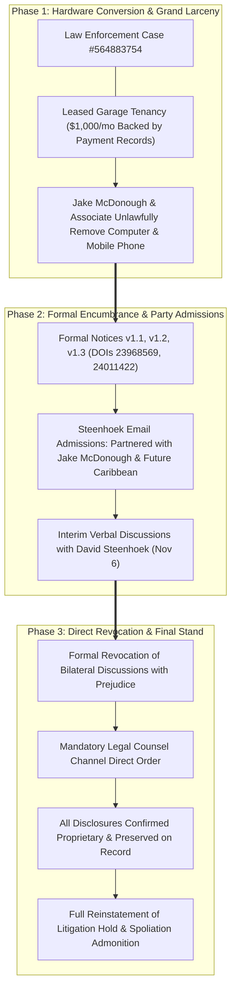

# SUPPLEMENTAL FORMAL NOTICE OF INTELLECTUAL PROPERTY ENCUMBRANCE, RECORD OF LEASED TENANCY HARDWARE REMOVAL, AND REINSTATED LITIGATION HOLD DIRECTIVE (V1.4)

**Date of Supplemental Notice:** November 6, 2026 (Post-Discussion Revocation & Reinstatement)  
**Criminal / Forensic Case Reference:** Law Enforcement / Forensic Case `#564883754`  
**Notice Version:** Version 1.4.0 (Forensic Supplement to Zenodo DOIs [`10.5281/zenodo.24011422`](https://doi.org/10.5281/zenodo.24011422), [`10.5281/zenodo.23968569`](https://doi.org/10.5281/zenodo.23968569), and [`10.5281/zenodo.24025547`](https://doi.org/10.5281/zenodo.24025547))  
**Underlying Prior-Art & Cryptographic Anchor DOIs:**  
* `doi:10.5281/zenodo.19482796` (*Baseline Forensic IP Report — SAEONYX & Geometric Foundation*, Published `2026-04-09`)  
* `doi:10.5281/zenodo.22862567` (*DNA-Lang Core Compiler, Write-Ahead Ledger & Lineage Specification*, Published `2026-09-20`)  
* `doi:10.5281/zenodo.23967473` (*osiris Physical QPU Validation Campaign — 663,552 IBM Heron r2 Shots*, Published `2026-11-04`)  
* `doi:10.5281/zenodo.23968474` (*Supplemental Forensic Prior-Art & Bitwise Architectural Audit — X5 / QE Channel Stack*, Published `2026-11-05`)  
* `doi:10.5281/zenodo.23968569` (*Formal Notice of IP Encumbrance & Litigation Hold Directive v1.1*, Published `2026-11-05`)  
* `doi:10.5281/zenodo.24011422` (*Supplemental Formal Notice of IP Encumbrance, Bad-Faith Escalation, and Litigation Hold Directive v1.2*, Published `2026-11-06`)  
* `doi:10.5281/zenodo.24025547` (*Formal Status Update & Bilateral Discussions Record v1.0*, Published `2026-11-06`)  

---

### ADDRESSEES / TARGETED PARTIES:

1. **Primary Infringing Entities & Officers:**  
   * **X5 Convergence & QE Channel**  
     Attn: **David Steenhoek** (Vice Chairman, Chief Creative Officer & "Quantum Dave"), **Paul Steenhoek** (VP Sales), **Jeremy L Christensen**, **Kevin O'Keefe**, and Legal / Compliance Department  
   * **SAEONYX Global Holdings LLC**  
     Attn: **Jake McDonough** (operating also as "Jake Macdonald")  
   * **Mediator Studios & Tesla Gold**  
     Attn: Corporate Officers and Directors  

2. **Institutional Facilitators, Hosts & Intermediaries (Constructive Notice):**  
   * **ACTAI Global**  
     Attn: **Bill Tai** (Venture Capitalist & Chairman)  
   * **Future Caribbean**  
     Attn: **Lily Dash** (Founder)  
   * **New York Stock Exchange (NYSE) Showcase Partners, Venture Capitalists & Syndicate Investors**  

---

### FROM:
**Devin Phillip Davis**  
Founder & Lead Systems Architect  
**Agile Defense Systems LLC** (`U.S. Federal CAGE Code: 9HUP5`)  
osiris Sovereign Architecture & DNA-Lang Project  

---

---

## I. OPERATIVE FORMAL STATEMENT OF RECORD

Effective immediately on the evening of November 6, 2026, **Devin Phillip Davis** issues the following formal operative statement of record to David Steenhoek, Jake McDonough, Paul Steenhoek, and all affiliated entities:

> **"For the record: Jake and his associate unlawfully removed my personal computer and mobile phone from a garage space I was actively leasing for $1,000 per month—a tenancy fully backed by documented payment records.**
> 
> **At this point, informal discussion is over. Direct any further communication through legal counsel.**
> 
> **Every email, attachment, and technical disclosure I have transmitted to either of you contains confidential, proprietary intellectual property and is preserved on the record. Effective immediately, formal notice and a full Litigation Hold are reinstated. You are hereby directed to immediately cease, desist, and freeze any use, reproduction, documentation, distribution, or presentation of any materials, code, architecture, or concepts related to osiris, DNA-Lang, or any derivative works thereof, including any data stored on the removed hardware.**
> 
> **Do not destroy, alter, or delete any communications, files, or physical hardware in your possession. All rights and remedies are expressly reserved."**

---

## II. FACTUAL RECORD: UNLAWFUL ENTRY, HARDWARE REMOVAL & DOCUMENTED TENANCY

1. **Lawful Leased Tenancy:**  
   Devin Phillip Davis maintained an active, lawful leasehold tenancy of the garage space where the hardware was housed, paying an active rental lease rate of **$1,000.00 per month**. This tenancy and exclusive right to possession are fully substantiated by contemporaneous banking records, payment receipts, and communications with the lessor.

2. **Unlawful Entry & Hardware Conversion:**  
   Without notice, judicial process, or authorization, **Jake McDonough** (operating also as "Jake Macdonald") and an associate unlawfully entered the leased premises and removed Devin Phillip Davis’s personal computer, engineering workstation drives, and mobile phone.

3. **Active Police Case & Statutory Exposure:**  
   This unlawful act is formally registered with law enforcement under **Case `#564883754`** and implicates:
   - **Grand Larceny & Commercial Burglary:** Unlawful physical removal of computing assets with documented replacement and trade secret value exceeding statutory felony thresholds.
   - **Federal Trade Secret Theft (18 U.S.C. § 1836 - DTSA):** Physical conversion of storage media containing proprietary code repositories (`osiris-cli`, `dnalang-core`, `living.py`), QPU transpiler sources, and cryptographic keys.
   - **Common Law Conversion & Trespass to Chattels:** Wrongful physical dominion and deprivation of property.
   - **Unlawful Self-Help Eviction:** Willful breach of tenancy and tenant protections.

---

## III. COMPLETE TERMINATION & REVOCATION OF INFORMAL DISCUSSIONS

1. **Immediate Revocation:**  
   All informal dialogue, exploratory technical discussions, proposed promotion or distribution alignments, and verbal exchanges between Devin Phillip Davis and David Steenhoek initiated earlier on November 6, 2026, are **formally terminated and revoked with prejudice**.
2. **Mandatory Communication Channel:**  
   No further direct informal contact (via telephone calls, SMS messages, unrecorded video meetings, or messaging apps) shall occur. **All future communications must be transmitted exclusively in writing between retained legal counsel.**

---

## IV. CONFIDENTIALITY & PROPRIETARY INTEGRITY OF ALL TRANSMITTED DISCLOSURES

1. **Proprietary Classification:**  
   Every electronic mail message, PDF brief, technical diagram, code snippet, benchmark metric, or verbal disclosure transmitted by Devin Phillip Davis to David Steenhoek, Paul Steenhoek, or Jake McDonough contains confidential, proprietary intellectual property belonging exclusively to **Agile Defense Systems LLC and Devin Phillip Davis**.
2. **No Implied License or Waiver:**  
   No transmission, discussion, or draft joint statement conveyed—or shall be construed as conveying—any license, assignment, promotional rights, partnership, or waiver of rights.
3. **Forensic Evidence Anchoring:**  
   All transmissions have been permanently captured with RFC 822 headers, cryptographic file digests, and forensic ledger sequences, ensuring non-repudiation in judicial proceedings.

---

## V. REINSTATED LITIGATION HOLD & CEASE AND DESIST MANDATE

Effective immediately, David Steenhoek, Jake McDonough, Paul Steenhoek, X5 Convergence, QE Channel, SAEONYX Global Holdings LLC, and all agents, contractors, and affiliates are hereby ordered to:

1. **Cease and Desist:**
   - Cease all use, commercialization, demonstration, or investor pitch presentations of any technology, code, or architecture derived from **osiris** or **DNA-Lang** (`dna::}{::lang`).
   - Immediately cease accessing, inspecting, booting, copying, extracting, or transferring any data residing on the unlawfully removed personal computer or mobile phone.
2. **Litigation Hold & Anti-Spoliation Directive (FRCP 37(e)):**
   - Retain and preserve all physical hardware, drives, mobile phones, and storage devices in their exact present condition without modification, deletion, or wiping.
   - Preserve all emails, text messages, chat transcripts, audio recordings, documents, pitch decks, and financial records involving Devin Phillip Davis, David Steenhoek, Jake McDonough, Paul Steenhoek, Bill Tai, Lily Dash, ACTAI Global, Future Caribbean, X5 Convergence, and SAEONYX.
   - Any deletion, wiping, alteration, or concealment of physical hardware or digital records will result in emergency applications for terminating sanctions, mandatory adverse inference instructions, and criminal obstruction referrals under 18 U.S.C. §§ 1503, 1512, and 1519.

---

## VI. RESERVATION OF RIGHTS & REMEDIES

Agile Defense Systems LLC and Devin Phillip Davis expressly reserve all rights, remedies, damages, and injunctive relief under federal, state, and common law. **NO RIGHTS OR REMEDIES ARE WAIVED.**

---

**SIGNED AND EXECUTED:**  
November 6, 2026

**Devin Phillip Davis**  
Founder & Lead Systems Architect  
**Agile Defense Systems LLC** (`CAGE: 9HUP5`)  
Managing Member & Lead Investigator, osiris Sovereign Architecture & DNA-Lang Project  
