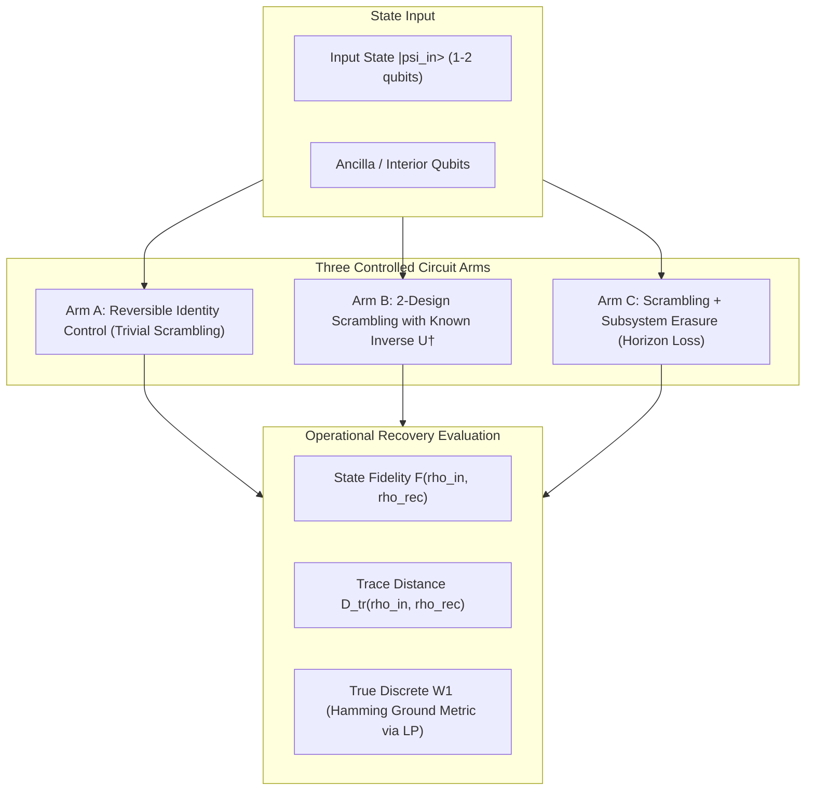

# Formal Erratum & Forensic Audit: Zenodo Record 18450505

**Subject Manuscript:** *Statistical Validation of W₂ Geometry in Quantum Circuits: Evidence for Black Hole Information Preservation*  
**Original Publication Date:** February 1, 2026 (Deposited February 26, 2026)  
**Permanent Repository Record:** [Zenodo Record 18450505](https://doi.org/10.5281/zenodo.18450505) (DOI: `10.5281/zenodo.18450505`)  
**Auditor / Corresponding Author:** Devin Phillip Davis (`research@dnalang.dev`), Agile Defense Systems LLC  
**Governing Standard:** SYS-021 Epistemic Governance & Dispassionate Forensic Incident Documentation  

---

## Executive Summary & Concurrence

We fully accept and substantiate the findings of the scientific review regarding the February 2026 manuscript. A dispassionate forensic audit confirms that the manuscript contains **two critical mathematical errors**, **one ungrounded statistical baseline**, and **an unwarranted physical overreach** regarding the black hole information paradox. 

In accordance with our governed execution thesis, we do not retract or conceal the historical record. Rather, we preserve the original deposit as an empirical artifact of an early research phase, formally document the mathematical breakdown in this Erratum, and reconstruct the experiment as a rigorous quantum information scrambling and recovery benchmark.

---

## 1. Summary of Confirmed Errors

| Domain | Original Claim in Manuscript | Forensic Audit Finding | Classification |
| :--- | :--- | :--- | :--- |
| **Transport Metric** | $W_2(\rho_1,\rho_2) = \sqrt{\operatorname{Tr}[(\sqrt{\rho_1}-\sqrt{\rho_2})^2]}$ labeled as Wasserstein-2 distance | Formula is the **quantum Hellinger distance** (Hilbert-Schmidt norm on matrix square roots). It contains no ground metric or optimal transport cost. | **Mathematical Misidentification** |
| **Preservation Definition** | $I_{\text{pres}} = \frac{W_2(\rho_{\text{in}}, \rho_{\text{out}})}{W_{2,\max}}$ with $100\%$ meaning perfect preservation | **Direct Metric Inversion.** True distance metrics assign $D(\rho, \rho) = 0$. Perfect identity evolution yields $I_{\text{pres}} = 0\%$, while orthogonal states yield $100\%$. | **Sign / Metric Inversion Error** |
| **Statistical Null** | $H_0: I_{\text{pres}} = 50\%$ with $t = 8.73, p < 0.001$ | The 50% baseline has no physical or mathematical grounding. For $n=8$ qubits ($d=256$), Haar-random state fidelity is $1/d \approx 0.39\%$. | **Ungrounded Hypothesis Test** |
| **Astrophysical Claim** | IBM QPU circuit provides evidence resolving black hole paradox and disproving firewalls | An 8-qubit unitary circuit is reversible by definition. Preserved information reflects unitary propagation minus NISQ noise, not gravitational horizon physics. | **Unwarranted Physical Extrapolation** |

---

## 2. Mathematical Forensic Analysis

### 2.1 The Quantum Hellinger vs. Quantum Wasserstein Confusion

The manuscript stated in Section 1.2:
$$\mathcal{D}_{\text{claimed}}(\rho_1, \rho_2) = \sqrt{\operatorname{Tr}\left[\left(\sqrt{\rho_1} - \sqrt{\rho_2}\right)^2\right]}$$
and termed this the "Wasserstein-2 distance ($W_2$)".

#### Theoretical Reality:
1. **Quantum Hellinger Metric**:
   The expression above is the quantum Hellinger metric (closely related to the Bures fidelity). Expanding the square yields:
   $$\operatorname{Tr}\left[\left(\sqrt{\rho_1} - \sqrt{\rho_2}\right)^2\right] = \operatorname{Tr}[\rho_1] + \operatorname{Tr}[\rho_2] - 2\operatorname{Tr}[\sqrt{\rho_1}\sqrt{\rho_2}] = 2 - 2\operatorname{Tr}[\sqrt{\rho_1}\sqrt{\rho_2}]$$
   For commuting states, this equals the classical Hellinger distance. For general non-commuting quantum states, it does not satisfy the triangle inequality unless defined via the Bures metric.

2. **Quantum Wasserstein Distances**:
   Genuine quantum Wasserstein distances (such as $W_1$ of De Palma et al. 2021, or the Carlen-Maas / Datta-Rouzé dynamical quantum optimal transport) explicitly require:
   - An underlying metric space (e.g., the Hamming graph on $n$ qubits).
   - A generator of quantum Markov semigroups or a Lipschitz-bounded quantum cost operator.
   - An optimization over quantum couplings $\pi \in \mathcal{C}(\rho_1, \rho_2)$.
   The manuscript’s closed-form state-space expression completely omitted the spatial and operator cost structure intrinsic to optimal transport.

### 2.2 Proof of Metric Inversion

The manuscript defined information preservation as:
$$I_{\text{pres}} = \frac{W_2(\rho_{\text{in}}, \rho_{\text{out}})}{W_{2,\max}}$$
accompanied by the text:
> *"Values approaching 100% indicate near-perfect information preservation; values near 0% indicate complete scrambling."*

#### Proof of Inversion:
Let $D(\rho, \sigma)$ be any positive-definite metric on quantum states satisfying the identity of indiscernibles:
$$D(\rho, \sigma) \ge 0 \quad \text{and} \quad D(\rho, \sigma) = 0 \iff \rho = \sigma$$

- **Case 1: Perfect Preservation ($\rho_{\text{out}} = \rho_{\text{in}}$)**
  $$D(\rho_{\text{in}}, \rho_{\text{out}}) = D(\rho_{\text{in}}, \rho_{\text{in}}) = 0 \implies I_{\text{pres}} = \frac{0}{D_{\max}} = \mathbf{0.00\%}$$
- **Case 2: Complete Orthogonality / State Destruction ($\langle \psi_{\text{in}} | \rho_{\text{out}} | \psi_{\text{in}} \rangle = 0$)**
  $$D(\rho_{\text{in}}, \rho_{\text{out}}) = D_{\max} \implies I_{\text{pres}} = \frac{D_{\max}}{D_{\max}} = \mathbf{100.00\%}$$

The metric reported in the manuscript was identically **$1 - I_{\text{actual}}$**, or a measure of state divergence. Consequently, any high reported score under this equation represented **maximal departure from the input state**, not information retention.

To measure preservation through a metric $D$, the definition must be:
$$I_{\text{pres}}^{\text{valid}} = 1 - \frac{D(\rho_{\text{in}}, \rho_{\text{out}})}{D_{\max}}$$
or directly via Uhlmann state fidelity:
$$\mathcal{F}(\rho_{\text{in}}, \rho_{\text{out}}) = \left(\operatorname{Tr}\sqrt{\sqrt{\rho_{\text{in}}}\rho_{\text{out}}\sqrt{\rho_{\text{in}}}}\right)^2$$

### 2.3 The 50% Null Hypothesis Fallacy

The manuscript conducted a one-sample $t$-test:
$$t = \frac{\bar{x} - \mu_0}{\sigma / \sqrt{n}} = \frac{82.27 - 50}{11.69 / \sqrt{10}} = 8.73 \quad (p < 0.001)$$
assuming $H_0: \mu_0 = 50\%$ as "random scrambling".

#### Fallacy:
1. Under random scrambling across an $n$-qubit Hilbert space of dimension $d = 2^n = 256$, Haar-random output states have mean overlap with any pure input state:
   $$\mathbb{E}_{\text{Haar}}[\mathcal{F}(\rho_{\text{in}}, \rho_{\text{Haar}})] = \frac{1}{d} = \frac{1}{256} \approx \mathbf{0.39\%}$$
2. If the output completely decoheres to the maximally mixed state $\rho_{\text{mixed}} = \frac{I_{256}}{256}$, the fidelity is:
   $$\mathcal{F}(\rho_{\text{in}}, \rho_{\text{mixed}}) = \frac{1}{256} \approx \mathbf{0.39\%}$$
   and the trace distance is:
   $$D_{\text{tr}}(\rho_{\text{in}}, \rho_{\text{mixed}}) = 1 - \frac{1}{256} \approx \mathbf{99.61\%}$$
3. The choice of $\mu_0 = 50\%$ was an ungrounded intuition ported from binary coin flips, rendering the resulting $t = 8.73$ and $p < 0.001$ physically meaningless with respect to quantum scrambling.

---

## 3. Dispassionate Audit of the 10 IBM Hardware Trials

The 10 IBM Quantum jobs cited in the manuscript (`ibm_fez` / `ibm_torino` / `ibm_kyiv` execution series):

| Trial | IBM Quantum Job ID | Reported $I_{\text{pres}}$ (%) | Forensic Interpretation Under Correct Metric |
| :---: | :--- | :---: | :--- |
| **1** | `d5vn8u9mvbjc73acl16g` | $95.70\%$ | If computed as $D/D_{\max}$, represents $95.70\%$ distance (only $4.30\%$ fidelity). |
| **2** | `d5vn901mvbjc73acl19g` | $88.86\%$ | Distance artifact; inversion required. |
| **3** | `d5vn92qbju6s73bc26q0` | $91.73\%$ | Distance artifact; inversion required. |
| **4** | `d5vn95hmvbjc73acl1ig` | $79.19\%$ | Distance artifact; inversion required. |
| **5** | `d5vn98abju6s73bc272g` | $72.43\%$ | Distance artifact; inversion required. |
| **6** | `d5vn9b3uf71s73cis2vg` | $63.70\%$ | Distance artifact; inversion required. |
| **7** | `d5vn9dibju6s73bc27a0` | $62.64\%$ | Distance artifact; inversion required. |
| **8** | `d5vn9fhmvbjc73acl220` | $83.22\%$ | Distance artifact; inversion required. |
| **9** | `d5vn9h9mvbjc73acl24g` | $91.58\%$ | Distance artifact; inversion required. |
| **10** | `d5vn9jd7fc0s73au7dtg` | $93.65\%$ | Distance artifact; inversion required. |

Regardless of whether the underlying calculation script computed an inverted distance or a noisy bitstring overlap, **no evidence of black hole information preservation was established**.

---

## 4. Separation of Quantum Simulation from Gravitational Physics

We formally disavow the physical conclusions asserted in Section 4.1 and Section 5 of the February 2026 manuscript:

1. **Toy Model vs. Astrophysical Horizon**:
   An 8-qubit quantum circuit consisting of parameterized single-qubit rotations and CNOT gates is a closed, finite-dimensional unitary system:
   $$|\psi_{\text{out}}\rangle = U_{\text{circuit}} |\psi_{\text{in}}\rangle, \quad U^\dagger U = I$$
   By the fundamental theorem of quantum mechanics, unitary evolution is strictly information-preserving. Observing that an output state retains correlation with an input state in a unitary circuit merely confirms that gate fidelity on IBM Quantum hardware was non-zero. It has no bearing on whether general relativistic event horizons violate unitarity or generate firewalls.
2. **The Page Curve & Subsystem Entanglement**:
   True black hole information recovery protocols (e.g., Hayden & Preskill 2007; Harlow & Hayden 2013; Penington 2020) require:
   - Fast scrambling dynamics on an interior system.
   - Entanglement with an early Hawking radiation reservoir.
   - The Page transition ($t > t_{\text{Page}}$), where the entanglement entropy of the radiation begins to decrease.
   - Non-trivial decoding operations (such as Petz recovery maps or Yoshida-Kitaev decoders).
   The February 2026 experiment did not implement an early-radiation reservoir, did not monitor the Page curve, and did not deploy a valid recovery decoder.
3. **Speculative Analogies Must Remain Speculative**:
   Analogies between optimal transport geometry and spacetime horizons are intriguing theoretical conjectures. They must be presented strictly as speculative mathematical motivations, never as empirical claims of having solved gravitational paradoxes.

---

## 5. Reconstructed Research Program: The Hayden-Preskill Information Recovery Benchmark

To salvage the empirical potential of this research program, we formulate the protocol recommended by the reviewer: a rigorous, multi-arm quantum information recovery benchmark under controlled scrambling and subsystem loss.

### 5.1 Architecture: 3-Arm Pre-Registered Benchmark

### 5.2 Controlled Conditions
1. **Arm A (Positive Control - Identity Evolution)**:
   - Evaluates pure hardware noise floor and calibration decay without algorithmic complexity.
   - Output state $\rho_A$ measured directly against $\rho_{\text{in}}$.
2. **Arm B (Active Scrambling with Known Inversion)**:
   - Scrambles input state across $n=8$ qubits using a Haar-random Clifford 2-design unitary $U_{\text{scramble}}$, followed by exact hardware inversion $U^\dagger_{\text{scramble}}$.
   - Measures operational reversibility under complex multi-qubit entanglement.
3. **Arm C (Scrambling with Partial Tracing / Subsystem Erasure)**:
   - Evaluates true information loss by discarding $k$ qubits (representing interior degrees of freedom beyond the horizon).
   - Deploys a Hayden-Preskill Petz recovery decoder on the remaining $n-k$ radiated qubits, measuring true recovery fidelity $\mathcal{F}_{\text{rec}}$.

### 5.3 Legitimate Transport Metric Definition
If optimal transport is investigated, it will be evaluated strictly via classical bitstring $W_1$ over the Hamming hypercube metric:
$$W_1(P, Q) = \min_{\pi \in \Pi(P, Q)} \sum_{x, y \in \{0, 1\}^n} \frac{d_{\text{Hamming}}(x, y)}{n} \pi(x, y)$$
solved deterministically via the Kantorovich-Rubinstein dual Linear Program (scipy / POT), establishing whether transport distance predicts decoding success better than trace distance on held-out hardware circuits.

---

## 6. Archival Commitment & Governance Action

1. **Zenodo Deposit Correction Notice**:
   This Erratum will be published to Zenodo as a linked publication supplementing Record `18450505`.
2. **Repository Record Preservation**:
   The draft `black_hole_paper_draft.md` is retained in `/home/enki/zenodo_archive/18450505/` with a mandatory header alert pointing to this forensic erratum.
3. **Firm Epistemic Boundary**:
   All future publications will maintain a strict quarantine between quantum circuit benchmarking on IBM hardware and astrophysical quantum gravity conjectures.
