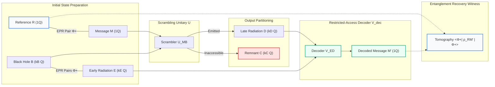
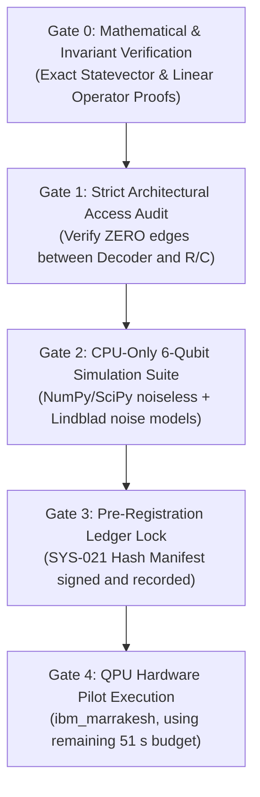

# OSIRIS-HP-001: Hayden–Preskill Quantum Information Recovery Benchmark
## Research Protocol v1.0 · CPU-First · QPU-Ready · Preregistration Candidate

**Document ID:** `OSIRIS-HP-001-PREREG-v1`  
**Date:** November 5, 2026  
**Lead Author / PI:** Devin Phillip Davis (`research@dnalang.dev`), Agile Defense Systems LLC  
**Protocol Standard:** SYS-021 Epistemic Governance & Pre-Registered Quantum Falsification  
**Target Repository:** `https://github.com/osiris-dnalang/osiris-cli`  

---

## 1. Executive Summary & Epistemic Scope

This protocol establishes a rigorous, falsifiable quantum information benchmark designed to investigate state reconstruction from scrambled quantum systems under restricted access and decoherence. 

### Core Scientific Thesis:
> **Can a quantum recovery decoder reconstruct an unknown input quantum state after it has been scrambled into an entangled system, and how does recovery degrade under noise and restricted access to the output degrees of freedom?**

### Explicit Boundary & Non-Claims:
1. **Operational Quantum Information Research**: This experiment evaluates finite-dimensional unitary scrambling and quantum state decoding across physical and simulated qubits.
2. **Quarantine of Gravitational Claims**: This protocol does **not** claim to simulate physical spacetime curvature, create event horizons, or resolve the astrophysical black hole information paradox. References to "black holes", "horizons", and "Hawking radiation" serve strictly as conceptual thought-experiment analogies connecting the protocol to the literature of Hayden & Preskill (2007) and Yoshida & Kitaev (2017).

---

## 2. Quantum Registers & Information Architecture

### Register Mapping ($n = 6$ Qubits Baseline)
| Register | Notation | Qubits | Role in Protocol | Access Policy |
| :--- | :---: | :---: | :--- | :--- |
| **Reference** | $R$ | $1$ | Entangled with message $M$ via $|\Phi^+\rangle_{RM}$. Holds reference entanglement. | **Quarantined**: Strictly untouched by $U$ and $V_{\text{dec}}$. |
| **Message** | $M$ | $1$ | Input state to be scrambled into the black hole interior. | Ingested by scrambler $U_{MB}$. |
| **Black Hole Interior** | $B$ | $k = 2$ | Interior degrees of freedom, initially maximally entangled with $E$. | Ingested by scrambler $U_{MB}$. |
| **Early Radiation** | $E$ | $k = 2$ | Pre-existing entanglement reservoir ($|E| = |B|$). | **Accessible**: Routed directly to decoder $V_{\text{dec}}$. |
| **Remnant** | $C$ | $k_C = 1$ | Subsystem remaining beyond the horizon after late emission. | **Inaccessible**: Discarded / traced out. |
| **Late Radiation** | $D$ | $k_D = 2$ | Newly emitted radiation carrying scrambled quantum information. | **Accessible**: Routed directly to decoder $V_{\text{dec}}$. |
| **Decoded Output** | $M'$ | $1$ | Reconstructed output state produced by $V_{\text{dec}}$. | Evaluated against $R$. |

---

## 3. The Three Experimental Benchmark Arms

### Arm A: Reversible Identity Recovery Control (Positive Reference)
- **Protocol**: 
  1. Prepare $|\Phi^+\rangle_{RM} \otimes |\Phi^+\rangle_{BE}$.
  2. Apply a known reversible unitary $U_{MB}$ across $M \cup B$.
  3. Apply the **full-access inverse** $U^\dagger_{MB}$ across $M \cup B$.
  4. Measure joint state $\rho_{RM}$.
- **Purpose**: Establishes the ideal state-preparation and measurement (SPAM) ceiling and calibrates the hardware noise floor.
- **Expected Ideal Result**: Unit entanglement recovery fidelity:
  $$F_{\text{rec}}^{\text{Arm A}} = \langle \Phi^+ | \rho_{RM} | \Phi^+ \rangle = 1.000000$$

### Arm B: Scrambling with Restricted-Access Recovery (Scientific Core)
- **Protocol**:
  1. Prepare $|\Phi^+\rangle_{RM} \otimes |\Phi^+\rangle_{BE}$.
  2. Scramble $M \cup B$ using a Haar-random / Clifford 2-design unitary $U_{MB}$.
  3. Output register partitioned into inaccessible remnant $C$ ($1$ qubit) and late radiation $D$ ($2$ qubits).
  4. **Strict Epistemic Isolation**: Remnant $C$ and Reference $R$ are physically quarantined.
  5. The restricted decoder $V_{\text{dec}}$ operates **exclusively** on $E \cup D$ (plus local ancillae).
  6. Output decoded qubit $M'$ is measured jointly with reference $R$.
- **Purpose**: Tests whether information can be reconstructed when $k_D \ge n_M + k_C$ without access to the remnant.
- **Theoretical Prediction**: For $k_D = 2 > k_C = 1$, Hayden-Preskill decoupling guarantees that mutual information $I(R : C) \approx 0$ and recovery fidelity exceeds the classical threshold:
  $$F_{\text{rec}}^{\text{Arm B}} > 0.50$$

### Arm C: Scrambling and Recovery Under Physical Noise (Engineering Stress-Test)
- **Protocol**:
  1. Execute Arm B circuit under calibrated open-system noise channels:
     - Amplitude damping ($T_1$ relaxation)
     - Phase damping ($T_2$ dephasing)
     - Single-qubit and two-qubit depolarizing gate noise
     - Readout measurement assignment error.
  2. Sweep noise rates $\Gamma / \Gamma_0 \in [0.1, 2.0]$.
- **Purpose**: Quantifies the physical decay rate of quantum recovery under realistic NISQ noise and determines whether the Hayden-Preskill mechanism survives on noisy superconducting QPUs.

---

## 4. Operational Observable: Entanglement Recovery Witness

The primary metric of success is the **Entanglement Recovery Fidelity** between Reference $R$ and Decoded Output $M'$:
$$F_{\text{rec}} = \langle \Phi^+ | \rho_{RM'} | \Phi^+ \rangle = \operatorname{Tr}\left[ |\Phi^+\rangle\langle\Phi^+| \, \rho_{RM'} \right]$$

### 2-Qubit Pauli Tomography Reconstruction:
Because $|\Phi^+\rangle = \frac{|00\rangle + |11\rangle}{\sqrt{2}}$, the projection operator expands into Pauli components:
$$|\Phi^+\rangle\langle\Phi^+| = \frac{I \otimes I + X \otimes X - Y \otimes Y + Z \otimes Z}{4}$$

Thus, on physical hardware, $F_{\text{rec}}$ is reconstructed from three standard 2-qubit measurement bases:
$$F_{\text{rec}} = \frac{1 + \langle X_R X_{M'} \rangle - \langle Y_R Y_{M'} \rangle + \langle Z_R Z_{M'} \rangle}{4}$$

### Decision Thresholds:
- **Classical / Separable Limit**: Any separable state $\rho_{\text{sep}} = \sum_i p_i \rho_R^{(i)} \otimes \rho_{M'}^{(i)}$ satisfies:
  $$F_{\text{rec}} \le 0.5000$$
- **Entanglement Verification**: An observed $F_{\text{rec}} > 0.5000$ (with $95\%$ bootstrap confidence interval strictly above $0.50$) serves as an unambiguous quantum witness that entanglement between $R$ and $M$ was successfully recovered through the radiation.
- **Matched Negative Control Baseline**: In every trial, Arm B is compared against an unentangled baseline where $B$ and $E$ are prepared in product states $|00\rangle \otimes |00\rangle$. Under the unentangled baseline, recovery must fail ($F_{\text{rec}} \le 0.50$).

---

## 5. Formal Pre-Registered Hypotheses & Falsification Conditions

| Hypothesis | Formal Prediction | Empirical Falsification Condition |
| :--- | :--- | :--- |
| **H1: Reversible Control** | Full-access inverse recovers message with unit fidelity: $\mathcal{F}_{\text{Arm A}} \ge 0.999$ in noiseless simulation. | $\mathcal{F}_{\text{Arm A}} < 0.999$ in noiseless execution. |
| **H2: Restricted Recovery** | For scramblers with $k_D \ge n_M + k_C$, decoder on $E \cup D$ recovers entanglement: $F_{\text{rec}} > 0.50$. | $F_{\text{rec}} \le 0.50$ or no statistically significant advantage over matched unentangled control ($p > 0.05$). |
| **H3: Page-Threshold Transition** | When accessible radiation size sweeps from $k_D < n_M$ to $k_D \ge n_M + k_C$, recovery fidelity exhibits a sharp transition from $F_{\text{rec}} \approx 0.25$ to $F_{\text{rec}} > 0.70$. | Recovery fidelity is invariant to radiation size $k_D$ after depth controls. |
| **H4: Noise Sensitivity** | Entanglement fidelity decays exponentially with integrated noise duration: $F_{\text{rec}}(\tau) \sim e^{-\gamma \tau}$, with entanglement ($F > 0.50$) preserved up to critical error threshold $\epsilon_{\text{crit}}$. | Non-monotonic response or failure of empirical data to fit Lindblad decay model ($R^2 < 0.85$). |

---

## 6. Execution Roadmap & Staged Gates

1. **Gate 0 (Passed)**: Mathematical erratum published on Zenodo (Record 23977106); metric inversion resolved.
2. **Gate 1 (Current)**: Implement the CPU-only simulation engine and restricted-access decoder with automated access audits.
3. **Gate 2**: Execute Arms A, B, and C across 100 independent Haar-random and Clifford scramblers on CPU.
4. **Gate 3**: Commit all simulation scripts, prediction manifests, and exact analysis pipelines to git and register the pre-registration hash $\mathcal{H}_{\text{prereg}}$ in the write-ahead ledger.
5. **Gate 4**: Stage 2 physical QPU execution will be triggered **only** after Gate 3 verification and upon receiving an explicit payload-bound SYS-021 execution grant.
