# Bipartite Staggered Dynamical Decoupling Under Residual $ZZ$ Crosstalk: A Controlled Comparison with Synchronous XY4 and XY8 Scheduling

**Author:** Devin Phillip Davis (Agile Defense Systems, LLC / CAGE: `9HUP5`)  
**Framework:** DNA::}{::lang v51.843 / OSIRIS v5.0 Sovereign Horizon  
**Governance Protocol:** SYS-021 (Payload-Bound Cryptographic Execution Receipts)  
**Benchmark Script:** [`benchmarks/bench_qiskit_vs_osiris_dd.py`](benchmarks/bench_qiskit_vs_osiris_dd.py) (`SHA-256: ed634a292a8cf165a2a31e02f32f285ab1278908688f9f8e880be7807994162c`)  
**Telemetry Record:** [`benchmarks/results_qiskit_vs_osiris_dd.json`](benchmarks/results_qiskit_vs_osiris_dd.json)  
**Date:** November 4, 2026  

---

## Abstract

Static inter-qubit $ZZ$ crosstalk ($\mathcal{H}_{ZZ} = \sum_{\langle u,v \rangle} \omega_{ZZ} Z_u Z_v$) is a primary coherent error source on fixed-frequency and tunable-coupler superconducting quantum processors with heavy-hex topology. Because synchronous transverse $\pi$-pulses applied simultaneously to coupled qubits commute with the bilinear operator $Z_u Z_v$, conventional synchronous dynamical decoupling (DD) sequences such as synchronous XY-4 and XY-8 fail to refocus static $ZZ$ phase accumulation. Exploiting the 2-colorability of the heavy-hex lattice, bipartite staggered DD offsets the pulse train on Sublattice $B$ relative to Sublattice $A$ so that every inter-pulse interval spends equal durations under $+\mathcal{H}_{ZZ}$ and $-\mathcal{H}_{ZZ}$.

In this controlled simulation study, we evaluate synchronous XY-4/XY-8 and bipartite staggered XY-4/XY-8 schedules on an 8-qubit heavy-hex chain (`[14, 15, 19, 35, 34, 33, 32, 31]`, 7 edges, $J_{ZZ} = 60.0\text{ kHz}$, $T = 32.0\,\mu\text{s}$) across three independent calculation engines: (1) closed-form toggling-frame integration, (2) an independent pure-NumPy/SciPy 256-dimensional matrix-exponential propagator (`scipy.linalg.expm`), and (3) Qiskit `Statevector` and 1,024-shot `AerSimulator` parity tomography. Second, we present a complete gate-by-gate mathematical post-mortem of an earlier fixed-offset simulation (`v1`, commit `6b4065ff`) in which staggered XY-4 yielded $11.75\%$ unsigned $XX$ retention while staggered XY-8 yielded $92.49\%$. We prove analytically that holding the sublattice offset fixed at $\Delta t = 160\text{ ns}$ across a $32.0\,\mu\text{s}$ window left an unrefocused net drift time $T_{\text{eff}} = T - (2N_p - 1)\Delta t$, placing staggered XY-4 ($T_{\text{eff}} = 30.88\,\mu\text{s}$, $2\Phi_{\text{eff}} = 7.4112\pi$) near the $7.5\pi$ coherence node and staggered XY-8 ($T_{\text{eff}} = 29.60\,\mu\text{s}$, $2\Phi_{\text{eff}} = 7.1040\pi$) near the $7.0\pi$ inverted antinode where $|+\rangle^{\otimes 8}$ maps to an orthogonal graph-like state ($F_{\text{global}} = 8.9 \times 10^{-12}$) whose negative boundary correlations ($\langle X_u X_v \rangle = -0.9471$) were masked by taking absolute values. When the sublattice stagger is properly duty-cycle-balanced ($\Delta t = \tau / 2 \implies T_{\text{eff}} = 0$), **both** bipartite staggered XY-4 and bipartite staggered XY-8 achieve exact refocusing ($F_{\text{global}} = 1.0000$, $\overline{\langle X \rangle} = +1.0000$, signed $\overline{\langle XX \rangle} = +1.0000$), compared to $F_{\text{global}} = 0.1575$ and $\overline{\langle XX \rangle} = +0.3582$ ($+0.3337 \pm 0.0217$ in 1,024-shot sampling) for synchronous XY-4 and XY-8. Finally, we demonstrate that Qiskit's native `PadDynamicalDecoupling` transpiler pass reproduces the exact same $1.0000$ refocusing when invoked in two sublattice-specific passes with custom `spacing` vectors, establishing that the physical advantage belongs to the **bipartite scheduling strategy** rather than a limitation of the Qiskit SDK.

---

## 1. Scope: Scheduling Strategy vs. SDK Capabilities

> [!IMPORTANT]
> **Methodological Boundary:** A comparison between a bipartite staggered schedule and Qiskit's default synchronous `PadDynamicalDecoupling` configuration is a comparison of **pulse-scheduling protocols**, not a proof that one software framework universally outperforms another.

Qiskit's `PadDynamicalDecoupling` (`qiskit.transpiler.passes.PadDynamicalDecoupling`) is a general circuit-scheduling pass whose constructor accepts both a target `qubits` subset and a custom relative `spacing` list:

```python
PadDynamicalDecoupling(
    durations: InstructionDurations,
    dd_sequence: list[Gate],
    qubits: list[int] | None = None,
    spacing: list[float] | None = None,
    pulse_alignment: int = 1,
)
```

When invoked with default arguments (`qubits=None, spacing=None`), `PadDynamicalDecoupling` applies symmetric spacings $\left[\frac{1}{2N_p}, \frac{1}{N_p}, \dots, \frac{1}{N_p}, \frac{1}{2N_p}\right]$ identically to all idling qubits, producing a **synchronous** DD schedule. However, if a heavy-hex coupling graph is first 2-colored into bipartite sublattices $V_A \cup V_B$, `PadDynamicalDecoupling` can be invoked sequentially on $V_A$ and $V_B$ with complementary offset vectors:
- **Sublattice $A$ (midpoint bisection):** $\text{spacing}_A = \left[\frac{1}{2N_p}, \frac{1}{N_p}, \dots, \frac{1}{N_p}, \frac{1}{2N_p}\right]$
- **Sublattice $B$ (interval endpoints):** $\text{spacing}_B = \left[\frac{1}{N_p}, \frac{1}{N_p}, \dots, \frac{1}{N_p}, 0\right]$

In this study, OSIRIS's [`BidirectionalDDCompiler`](osiris/quantum/bidirectional_dd.py) automates this heavy-hex 2-coloring and balanced stagger computation natively, while Arm 8 of our benchmark (`qiskit_custom_bipartite_xy8`) constructs the identical schedule using Qiskit's `ALAPScheduleAnalysis` and `PadDynamicalDecoupling` passes. Both implementations produce identical unitary evolution and identical $100\%$ coherence retention.

---

## 2. Physical Model, Hamiltonian Units, and Observable Definitions

### 2.1 Heavy-Hex Chain Topology and Bipartite Partition
We model an 8-qubit linear subchain of the 156-qubit IBM Heron r2 (`ibm_marrakesh` / `ibm_kingston`) coupling map:
- **Ordered Qubit Chain ($N = 8$):** $V = [14, 15, 19, 35, 34, 33, 32, 31]$
- **Coupling Edges ($|E| = 7$):**
  $$E = \{(14, 15), (15, 19), (19, 35), (35, 34), (34, 33), (33, 32), (32, 31)\}$$
  Of these 7 edges, **2 are boundary edges**—$(14, 15)$ and $(32, 31)$, each sharing one vertex of degree 1 and one vertex of degree 2—and **5 are interior edges**, each sharing two vertices of degree 2.
- **Bipartite 2-Coloring ($E \subseteq V_A \times V_B$):**
  $$V_A = \{14, 19, 34, 32\} \quad (\text{indices } \{0, 2, 4, 6\}), \qquad V_B = \{15, 35, 33, 31\} \quad (\text{indices } \{1, 3, 5, 7\})$$

### 2.2 Crosstalk Hamiltonian and Unitary Conventions
During an idle window of total duration $T = 32.0\,\mu\text{s}$, the system evolves under the static nearest-neighbor $ZZ$ Hamiltonian ($\hbar = 1$):

$$\mathcal{H}_{ZZ} = \sum_{(u,v) \in E} \omega_{ZZ} Z_u Z_v, \qquad \omega_{ZZ} = 2\pi J_{ZZ}$$

with $J_{ZZ} = 60.0\text{ kHz} = 0.060\,\mu\text{s}^{-1}$ ($\omega_{ZZ} = 0.120\pi\text{ rad}/\mu\text{s} \approx 0.3770\text{ rad}/\mu\text{s}$). Over any free-drift interval of duration $\Delta t$, the exact unitary propagator is:

$$U_{\text{free}}(\Delta t) = \exp(-i \mathcal{H}_{ZZ} \Delta t) = \prod_{(u,v) \in E} \exp(-i \omega_{ZZ} \Delta t Z_u Z_v) = \prod_{(u,v) \in E} R_{ZZ}(2\omega_{ZZ}\Delta t)$$

where Qiskit's two-qubit gate $R_{ZZ}(\theta) = \exp\!\left(-i \frac{\theta}{2} Z_u Z_v\right)$ is parameterized by $\theta = 2\omega_{ZZ}\Delta t = 4\pi J_{ZZ}\Delta t$. All transverse control pulses ($X, Y$) are modeled in the instantaneous impulse limit ($t_{\text{pulse}} \to 0$).

### 2.3 State Preparation and Distinct Fidelity / Correlation Metrics
The register is initialized in the product state $|\psi(0)\rangle = H^{\otimes 8}|0\rangle^{\otimes 8} = |+\rangle^{\otimes 8}$, which is a $+1$ eigenstate of every single-qubit $X_u$ and two-qubit $X_u X_v$ stabilizer. Because single-qubit retention, two-qubit correlation, and global state overlap behave differently under multi-qubit $ZZ$ evolution, we define and report four distinct metrics at $t = T$:

1. **Global 8-Qubit State Fidelity ($F_{\text{global}}$):**
   $$F_{\text{global}} = \left|\langle +|^{\otimes 8} |\psi(T)\rangle\right|^2$$
2. **Mean Single-Qubit Transverse Coherence ($\overline{\langle X \rangle}$):**
   $$\overline{\langle X \rangle} = \frac{1}{|V|} \sum_{u \in V} \langle \psi(T) | X_u | \psi(T) \rangle$$
3. **Mean Signed Two-Point Edge Correlation ($\overline{\langle XX \rangle}_{\text{signed}}$):**
   $$\overline{\langle XX \rangle}_{\text{signed}} = \frac{1}{|E|} \sum_{(u,v) \in E} \langle \psi(T) | X_u X_v | \psi(T) \rangle$$
4. **Mean Rectified Two-Point Edge Magnitude ($\overline{|\langle XX \rangle|}$):**
   $$\overline{|\langle XX \rangle|} = \frac{1}{|E|} \sum_{(u,v) \in E} \left|\langle \psi(T) | X_u X_v | \psi(T) \rangle\right|$$

---

## 3. Exact Toggling-Frame Derivation

Let $U_P(t)$ denote the cumulative product of instantaneous single-qubit Pauli pulses ($X_q$ or $Y_q$) applied from $t = 0$ to time $t$. Because both XY-4 ($X Y X Y = -I$) and XY-8 ($X Y X Y Y X Y X = +I$) resolve to the identity operator up to a global phase on every qubit at $t = T$, the final state is governed completely by the toggling-frame Hamiltonian $\widetilde{\mathcal{H}}_{ZZ}(t) = U_P^\dagger(t) \mathcal{H}_{ZZ} U_P(t)$.

Since every transverse Pauli gate $P_q \in \{X_q, Y_q\}$ anti-commutes with $Z_q$ ($P_q Z_q P_q^\dagger = -Z_q$) and every edge $(u,v) \in E$ connects $u \in V_A$ to $v \in V_B$:

$$U_P^\dagger(t) (Z_u Z_v) U_P(t) = (-1)^{N_A(t) + N_B(t)} Z_u Z_v$$

where $N_A(t)$ and $N_B(t)$ are the cumulative integer counts of $\pi$-pulses applied up to time $t$ on Sublattices $A$ and $B$, respectively. Crucially, because all bond operators commute ($\left[Z_u Z_v, Z_w Z_k\right] = 0$), $\left[\widetilde{\mathcal{H}}_{ZZ}(t_1), \widetilde{\mathcal{H}}_{ZZ}(t_2)\right] = 0$ for all $t_1, t_2$. Therefore, all higher-order Magnus commutator terms vanish identically ($\Omega_2 = \Omega_3 = \dots = 0$), and the exact propagator at $t = T$ is:

$$U_{\text{eff}}(T) = \pm \exp(-i \mathcal{H}_{ZZ} T_{\text{eff}}), \qquad T_{\text{eff}} = \int_0^T (-1)^{N_A(t) + N_B(t)}\,dt = T_+ - T_-$$

where $T_+$ is the total duration spent in the even-parity frame ($N_A(t) + N_B(t)$ even) and $T_-$ is the total duration spent in the odd-parity frame ($N_A(t) + N_B(t)$ odd).

Defining the net accumulated bond phase $\Phi_{\text{eff}} = \omega_{ZZ} T_{\text{eff}} = 2\pi J_{ZZ} T_{\text{eff}}$ and $c = \cos(2\Phi_{\text{eff}})$:
- **Global Fidelity:** Because the 7 bond operators $Z_u Z_v$ on an open chain are algebraically independent and satisfy $\langle +|^{\otimes 8} \prod_{e \in S} (Z_u Z_v)_e |+\rangle^{\otimes 8} = 0$ for every non-empty subset $S \subseteq E$, only the $(\cos \Phi_{\text{eff}})^7 I$ term in $\prod_{e=1}^7 (\cos\Phi_{\text{eff}} I - i\sin\Phi_{\text{eff}} Z_{u_e} Z_{v_e})$ contributes to the overlap:
  $$F_{\text{global}}(T_{\text{eff}}) = (\cos^2 \Phi_{\text{eff}})^7$$
- **Single-Qubit Coherence:** For any qubit $u$ of graph degree $d_u \in \{1, 2\}$, $X_u$ anti-commutes with the $d_u$ incident bond operators and commutes with the remaining $7 - d_u$ bonds, yielding $\langle X_u \rangle = \cos(2\Phi_{\text{eff}})^{d_u} = c^{d_u}$. Averaging over the 2 boundary qubits ($d_u = 1$) and 6 interior qubits ($d_u = 2$):
  $$\overline{\langle X \rangle}(T_{\text{eff}}) = \frac{2c + 6c^2}{8}$$
- **Two-Point $XX$ Correlation:** For any edge $(u,v) \in E$, the product $X_u X_v$ commutes with its own bond operator $Z_u Z_v$ ($X_u X_v Z_u Z_v = +Z_u Z_v X_u X_v$) and anti-commutes with the $(d_u - 1) + (d_v - 1)$ adjacent external edges. Thus, the 2 boundary edges have 1 external neighbor ($\langle X_u X_v \rangle = c^1$) and the 5 interior edges have 2 external neighbors ($\langle X_u X_v \rangle = c^2$):
  $$\overline{\langle XX \rangle}_{\text{signed}}(T_{\text{eff}}) = \frac{2c + 5c^2}{7}, \qquad \overline{|\langle XX \rangle|}(T_{\text{eff}}) = \frac{2|c| + 5c^2}{7}$$

```mermaid
flowchart TD
    subgraph S1["1. Synchronous XY-4 / XY-8 (Delta_t = 0)"]
        direction LR
        A1["Sublattice A & B fire simultaneously at t_k = k*tau"] --> B1["N_A(t) + N_B(t) is ALWAYS EVEN (+1)"]
        B1 --> C1["T_+ = 32.00 us, T_- = 0.00 us -> T_eff = 32.00 us"]
    end
    subgraph S2["2. Legacy v1 Fixed-160ns Stagger (Delta_t = 0.16 us << tau/2)"]
        direction LR
        A2["Sublattice B fires 0.16 us after Sublattice A"] --> B2["Odd parity (-1) only during N_p windows of width 0.16 us"]
        B2 --> C2["XY-4: T_eff = 30.88 us (2*Phi = 7.41*pi) | XY-8: T_eff = 29.60 us (2*Phi = 7.10*pi)"]
    end
    subgraph S3["3. Balanced Bipartite Stagger (Delta_t = tau/2)"]
        direction LR
        A3["Sublattice A fires at (k+1/2)*tau, Sublattice B at (k+1)*tau"] --> B3["Every interval tau split 50/50 between +H_ZZ and -H_ZZ"]
        B3 --> C3["T_+ = 16.00 us, T_- = 16.00 us -> T_eff = 0.00 us (Exact Cancellation)"]
    end
```



---

## 4. Forensic Audit of the v1 Diagnostic Anomaly ($11.75\%$ Stag-XY4 vs. $92.49\%$ Stag-XY8)

In the initial version of the benchmark script (`commit 6b4065ff`), three numbers stood out as a diagnostic warning in 1,024-shot Aer sampling:
- **Free Evolution / Synchronous XY-4 / Synchronous XY-8:** $33.37\%$ ($0.3582$ exact noiseless)
- **Legacy v1 Staggered XY-4 ($\Delta t = 160\text{ ns}$):** $11.75\%$ ($0.1328$ exact noiseless)
- **Legacy v1 Staggered XY-8 ($\Delta t = 160\text{ ns}$):** $92.49\%$ ($0.9113$ exact noiseless)

Applying the exact toggling-frame equations from Section 3 exposes two interacting root causes in `v1` that fully explain these values to 6 decimal places:

### 4.1 Root Cause 1: Fixed $160\text{ ns}$ Hardware Offset vs. $32\,\mu\text{s}$ Window Scaling
On physical IBM Heron hardware (`ibm_marrakesh`), a sublattice stagger of $\Delta t = 160\text{ ns}$ corresponds to a $50\%$ duty cycle ($\Delta t = \tau / 2$) when the inter-pulse delay is $\tau = 320\text{ ns}$. However, in the `v1` simulation script, the total idling window was set to $T = 32.0\,\mu\text{s}$ ($\tau = 6.40\,\mu\text{s}$ for XY-4 and $\tau = 3.56\,\mu\text{s}$ for XY-8) while `stagger_ns` was left fixed at $160\text{ ns}$ ($0.160\,\mu\text{s}$), and the final circuit duration was extended to $T + \Delta t = 32.16\,\mu\text{s}$.

Consequently, only $T_- = N_p \Delta t$ was spent in the refocussing $-\mathcal{H}_{ZZ}$ frame ($0.64\,\mu\text{s}$ for XY-4; $1.28\,\mu\text{s}$ for XY-8), while $T_+ = (T + \Delta t) - N_p \Delta t$ remained in the $+\mathcal{H}_{ZZ}$ frame, leaving an unrefocused net drift time $T_{\text{eff}} = T_+ - T_- = T - (2N_p - 1)\Delta t$:

1. **Free Evolution & Synchronous XY-4 / XY-8 ($N_p \in \{0, 4, 8\}, \Delta t = 0$):**
   $$T_{\text{eff}} = 32.00\,\mu\text{s} \implies 2\Phi_{\text{eff}} = 4\pi (0.060)(32.00) = 7.6800\pi\text{ rad}$$
   $$c = \cos(7.6800\pi) = +0.535827 \implies \overline{\langle XX \rangle}_{\text{signed}} = \overline{|\langle XX \rangle|} = \frac{2(0.535827) + 5(0.287110)}{7} = \mathbf{0.358172}$$
   (sampled at 1,024 shots with `seed_simulator=42`: **$0.3337 \pm 0.0217$**).

2. **Legacy v1 Fixed-$160\text{ ns}$ Staggered XY-4 ($N_p = 4, \Delta t = 0.160\,\mu\text{s}$):**
   $$T_{\text{eff}} = 32.00 - 7(0.160) = 30.88\,\mu\text{s} \implies 2\Phi_{\text{eff}} = 4\pi (0.060)(30.88) = 7.4112\pi\text{ rad}$$
   Because $7.4112\pi$ lies right beside the coherence zero-crossing at $7.5\pi$, $c = \cos(7.4112\pi) = -0.275237$ is small and negative:
   $$\overline{\langle XX \rangle}_{\text{signed}} = \frac{2(-0.275237) + 5(0.075755)}{7} = \mathbf{-0.024514}, \qquad \overline{|\langle XX \rangle|} = \frac{2(0.275237) + 5(0.075755)}{7} = \mathbf{0.132840}$$
   (sampled at 1,024 shots: **$-0.0343 \pm 0.0229$ signed**, **$0.1175$ unsigned**).

3. **Legacy v1 Fixed-$160\text{ ns}$ Staggered XY-8 ($N_p = 8, \Delta t = 0.160\,\mu\text{s}$):**
   $$T_{\text{eff}} = 32.00 - 15(0.160) = 29.60\,\mu\text{s} \implies 2\Phi_{\text{eff}} = 4\pi (0.060)(29.60) = 7.1040\pi\text{ rad}$$
   Because $7.1040\pi$ lies just past the **odd-$\pi$ antinode** at $7.0\pi$ ($\Phi_{\text{eff}} = 3.552\pi \approx 3.5\pi$), $c = \cos(7.1040\pi) = \mathbf{-0.947098}$!

### 4.2 Root Cause 2: Parity-Even Interior Squaring and `abs()` Sign Masking at the $7\pi$ Antinode
At $2\Phi_{\text{eff}} = 7.1040\pi$ ($\Phi_{\text{eff}} = 3.552\pi$), $\cos(\Phi_{\text{eff}}) = +0.1626$ and $\sin(\Phi_{\text{eff}}) = -0.9867$. Each bond propagator $\exp(-i\Phi_{\text{eff}} Z_u Z_v)$ is therefore nearly a pure $-i Z_u Z_v$ entangling gate, mapping $|+\rangle^{\otimes 8}$ to an **orthogonal 1D cluster-like state** whose true 8-qubit fidelity with $|+\rangle^{\otimes 8}$ is:

$$F_{\text{global}} = (\cos^2(3.552\pi))^7 = (0.02645)^7 = \mathbf{8.91 \times 10^{-12} \approx 0.0000}$$

Why, then, did `v1` report $91.13\%$ noiseless ($92.49\%$ sampled) $XX$ retention?
- On the **5 interior edges**, $X_u X_v$ anti-commutes with **two** adjacent $Z Z$ gates (one on the left, one on the right). The two minus signs cancel: $\langle X_u X_v \rangle = c^2 = (-0.947098)^2 = \mathbf{+0.896995}$.
- On the **2 boundary edges**, $X_u X_v$ anti-commutes with **one** adjacent $Z Z$ gate, so the correlation is **inverted**: $\langle X_u X_v \rangle = c^1 = \mathbf{-0.947098}$.
- Therefore, the true **signed** edge correlation was only $\overline{\langle XX \rangle}_{\text{signed}} = \frac{2(-0.947098) + 5(0.896995)}{7} = \mathbf{+0.370111}$ (and single-qubit retention was $\overline{\langle X \rangle} = \mathbf{+0.435972}$).
- However, because line 178 of `v1` computed `mean_abs_val = np.mean([abs(v) for v in corrs.values()])`, the negative sign on the 2 boundary edges was rectified to $+0.947098$, producing $\overline{|\langle XX \rangle|} = \frac{2(0.947098) + 5(0.896995)}{7} = \mathbf{0.911310}$ ($0.9249$ with shot noise).

---

## 5. Three-Engine Independent Numerical Validation

When the sublattice stagger is properly set to the midpoint bisection $\Delta t = \tau / 2$ ($\Delta t = 4.0\,\mu\text{s}$ for XY-4; $\Delta t = 2.0\,\mu\text{s}$ for XY-8), every cycle of duration $\tau$ spends $\tau / 2$ in $+\mathcal{H}_{ZZ}$ and $\tau / 2$ in $-\mathcal{H}_{ZZ}$, yielding $T_+ = 16.00\,\mu\text{s}$, $T_- = 16.00\,\mu\text{s}$, and $T_{\text{eff}} = 0.00\,\mu\text{s}$.

Table 1 reports the complete 8-arm comparison verified across our three independent engines:
1. **Engine 1 (Closed-Form Analytical Toggling Frame):** Equations in Section 3.
2. **Engine 2 (Independent Pure-NumPy/SciPy Propagator):** 256-dimensional statevector evolved via `scipy.linalg.expm(-1j * H_ZZ * dt)` without importing Qiskit.
3. **Engine 3 (Qiskit `Statevector` + `AerSimulator`):** Exact noiseless Qiskit `Statevector` plus 1,024-shot parity tomography (`seed_simulator=42`) with $95\%$ confidence intervals.

### Table 1: Controlled 8-Arm Comparison Across Analytical, SciPy, and Qiskit Engines ($T = 32.0\,\mu\text{s}, J_{ZZ} = 60.0\text{ kHz}$)

| Protocol Arm | $T_+$ ($\mu\text{s}$) | $T_-$ ($\mu\text{s}$) | $T_{\text{eff}}$ ($\mu\text{s}$) | $2\Phi_{\text{eff}} / \pi$ | Global Fidelity $F_{\text{global}}$ | Single-Qubit $\overline{\langle X \rangle}$ | Signed $\overline{\langle XX \rangle}$ (Analytical / SciPy / Qiskit SV) | Unsigned $\overline{|\langle XX \rangle|}$ (Noiseless) | Aer 1,024-Shot Signed $\overline{\langle XX \rangle}$ ($\pm 95\%$ CI) | Aer 1,024-Shot Unsigned $\overline{|\langle XX \rangle|}$ |
| :--- | :---: | :---: | :---: | :---: | :---: | :---: | :---: | :---: | :---: | :---: |
| **1. Free Evolution (No DD)** | $32.00$ | $0.00$ | $32.00$ | $7.6800$ | $0.1575$ | $+0.3493$ | $+0.3582$ | $0.3582$ | $+0.3337 \pm 0.0217$ | $0.3337$ |
| **2. Qiskit Default Sync XY-4** ($\Delta t = 0$) | $32.00$ | $0.00$ | $32.00$ | $7.6800$ | $0.1575$ | $+0.3493$ | $+0.3582$ | $0.3582$ | $+0.3337 \pm 0.0217$ | $0.3337$ |
| **3. Qiskit Default Sync XY-8** ($\Delta t = 0$) | $32.00$ | $0.00$ | $32.00$ | $7.6800$ | $0.1575$ | $+0.3493$ | $+0.3582$ | $0.3582$ | $+0.3337 \pm 0.0217$ | $0.3337$ |
| **4. Legacy v1 Fixed-160ns Stag XY-4** | $31.52$ | $0.64$ | $30.88$ | $7.4112$ | $0.0008$ | $-0.0120$ | $-0.0245$ | $0.1328$ | $-0.0343 \pm 0.0229$ | $0.1175$ |
| **5. Legacy v1 Fixed-160ns Stag XY-8** | $30.88$ | $1.28$ | $29.60$ | $7.1040$ | $0.0000$ | $+0.4360$ | $+0.3701$ | $0.9113$ | $+0.3803 \pm 0.0088$ | $0.9249$ |
| **6. OSIRIS Balanced Bipartite XY-4** ($\Delta t = \tau/2$) | $16.00$ | $16.00$ | **$0.00$** | **$0.0000$** | **$1.0000$** | **$+1.0000$** | **$+1.0000$** | **$1.0000$** | **$+1.0000 \pm 0.0000$** | **$1.0000$** |
| **7. OSIRIS Balanced Bipartite XY-8** ($\Delta t = \tau/2$) | $16.00$ | $16.00$ | **$0.00$** | **$0.0000$** | **$1.0000$** | **$+1.0000$** | **$+1.0000$** | **$1.0000$** | **$+1.0000 \pm 0.0000$** | **$1.0000$** |
| **8. Qiskit Custom Sublattice-Spaced XY-8** ($\Delta t = \tau/2$) | $16.00$ | $16.00$ | **$0.00$** | **$0.0000$** | **$1.0000$** | **$+1.0000$** | **$+1.0000$** | **$1.0000$** | **$+1.0000 \pm 0.0000$** | **$1.0000$** |

### Numerical Concordance Summary
- **Maximum discrepancy between Independent SciPy `expm` and Closed-Form Toggling-Frame Integration:** $0.00 \times 10^0$ (exact machine-precision agreement across all 8 arms).
- **Maximum discrepancy between Qiskit `Statevector` and Independent SciPy `expm`:** $3.93 \times 10^{-7}$ (attributable solely to nanosecond integer rounding $32,000 / 9\text{ ns}$ inside `InstructionDurations` for synchronous 8-pulse spacing).
- **Off-Axis Parasitic $\overline{\langle YY \rangle}$ Drift:** Identically $0.0000$ noiseless ($0.0156 \pm 0.0231$ shot-noise floor at 1,024 shots) across all arms.

---

## 6. Conclusions and Pre-Registered Hardware Protocol

1. **Both Balanced Bipartite XY-4 and Balanced Bipartite XY-8 Refocus Static $ZZ$ Crosstalk Identically:** When the sublattice stagger bisects each inter-pulse window ($\Delta t = \tau / 2$), both 4-pulse and 8-pulse bipartite schedules cancel $\mathcal{H}_{ZZ}$ to first order (and to all orders for pure commuting $ZZ$ coupling), restoring $F_{\text{global}} = 1.0000$ and signed $\overline{\langle XX \rangle} = +1.0000$ versus $+0.3582$ for synchronous XY-4/XY-8.
2. **Schedule vs. Framework Attribution:** Because Qiskit's `PadDynamicalDecoupling` pass achieves the exact same $1.0000$ retention when invoked twice with bipartite `qubits` and `spacing` arguments (Arm 8), the physical gain is a property of **bipartite sublattice-staggered scheduling** rather than an inherent limitation of Qiskit's transpiler. OSIRIS's contribution lies in automating heavy-hex 2-coloring, closed-loop spectator $ZZ$ tomography, and cryptographic payload-bound governance (`SYS-021`).
3. **Diagnostic Value of Separate Observable Reporting:** Reporting $F_{\text{global}}$, $\overline{\langle X \rangle}$, and signed $\overline{\langle XX \rangle}$ alongside unsigned $\overline{|\langle XX \rangle|}$ immediately distinguishes genuine state preservation ($T_{\text{eff}} = 0$) from odd-$\pi$ cluster-state antinodes ($2\Phi_{\text{eff}} \approx (2k+1)\pi$).
4. **Motivation for Physical Hardware Execution:** In physical superconducting processors with finite pulse durations ($t_{\text{pulse}} \approx 32\text{–}68\text{ ns}$), $T_1 / T_2$ relaxation, and non-commuting single-qubit detuning $\Delta_u Z_u$, higher-order Magnus terms ($\left[Z_u Z_v, X_u\right] \neq 0$ during finite-width pulses) become non-zero. The validated simulation suite in [`benchmarks/bench_qiskit_vs_osiris_dd.py`](benchmarks/bench_qiskit_vs_osiris_dd.py) provides the exact baseline required for a pre-registered, duty-cycle-balanced ($\Delta t = \tau / 2$) hardware comparison on `ibm_marrakesh`.
