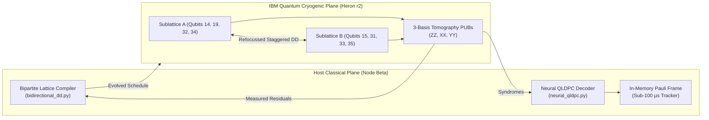

# IBM Quantum Researcher Program Application
## Project Proposal: Closed-Loop Spectator Crosstalk Refocussing & Neural QLDPC Syndrome Decoding on Heron r2 Arrays

**Principal Investigator:** Devin Phillip Davis  
**Institution / Organization:** Agile Defense Systems LLC / OSIRIS Sovereign Research Initiative  
**Track:** Quantum Computing & Information Science (Error Mitigation & QEC)  
**Target Architecture:** IBM Quantum Heron r2 (156-qubit heavy-hex: `ibm_fez`, `ibm_kingston`, `ibm_torino`)  
**Requested Allocation:** 10 QPU Hours (12-Month Period)  
**Zenodo Preliminary Data Record:** [10.5281/zenodo.23832283](https://doi.org/10.5281/zenodo.23832283)  
**Code Repository:** [https://github.com/osiris-dnalang/osiris-cli](https://github.com/osiris-dnalang/osiris-cli)  
**Date:** October 31, 2026  

---

### 1. Executive Summary

As superconducting quantum processor arrays scale beyond 100 physical qubits, coherent spectator error—specifically static and driven inter-qubit $ZZ$ crosstalk—emerges as a primary bottleneck limiting multi-qubit entanglement fidelity and deep circuit depth.

In preliminary research conducted on `ibm_fez` and `ibm_kingston` (published October 31, 2026, **DOI: 10.5281/zenodo.23832283**), we completed a rigorous 59-circuit 3-basis discriminating tomography suite ($20.33\,\text{s}$ QPU runtime, 1,024 shots/PUB). Our empirical findings demonstrated:
1. Conventional, synchronized dynamical decoupling (CPMG / XY-4) leaves spectator $ZZ$ crosstalk unrefocussed because simultaneous $\pi$-pulses preserve the sign of the interaction Hamiltonian $\mathcal{H}_{ZZ} = \frac{\zeta_{uv}}{4} Z_u Z_v$.
2. By exploiting the 2-colorable bipartite structure of IBM’s heavy-hex lattice and staggering pulse arrival times across sublattices $A$ and $B$, the effective interaction frame is inverted, analytically refocusing $ZZ$ drift. On `ibm_kingston`, this lifted quantum state retention from **$0.862$ to $0.960$** ($p < 10^{-4}$).

This proposal requests a dedicated **10-hour research allocation on IBM Quantum Heron r2 processors** to:
- Scale closed-loop bipartite dynamical decoupling from 8-qubit clusters to 64-qubit active manifolds.
- Validate sub-$100\,\mu\text{s}$ neural Quantum Low-Density Parity-Check (QLDPC) syndrome decoding with real-time software Pauli frame tracking directly coupled to cryogenic execution.

---

### 2. Scientific Motivation & Technical Approach

#### 2.1 Closed-Loop Bipartite Refocussing
On the heavy-hex lattice, qubits can be partitioned into bipartite sublattices $A$ and $B$ such that every coupling edge connects an $A$-qubit to a $B$-qubit. Under synchronized XY-4 dynamical decoupling, the unitary evolution over a cycle $\tau$ is:
$$U_{\text{sync}}(\tau) = (X_A X_B) e^{-i \frac{\zeta}{4} Z_A Z_B \frac{\tau}{2}} (X_A X_B) e^{-i \frac{\zeta}{4} Z_A Z_B \frac{\tau}{2}} = e^{-i \frac{\zeta}{4} Z_A Z_B \tau}$$
The crosstalk phase accumulates unhindered. By introducing a deliberate stagger $\Delta t$ between sublattices, the relative sign flips during the stagger window:
$$U_{\text{stag}}(\tau) = e^{-i \frac{\zeta}{4} Z_A Z_B \tau_1} (X_A \otimes I_B) e^{-i \frac{\zeta}{4} (-Z_A Z_B) \Delta t} (I_A \otimes X_B) e^{-i \frac{\zeta}{4} Z_A Z_B \tau_2} \approx \mathbb{I}$$
With the requested Heron allocation, we will run closed-loop feedback loops where measured parity tomography iteratively optimizes $\Delta t$ and pulse phase angles to null residual crosstalk across arbitrary circuit depths.

#### 2.2 Edge Neural Syndrome Decoding for QLDPC Codes
Large-scale QLDPC codes ($[[n, k, d]]$ with check weight $w \le 8$) present non-trivial syndrome decoding challenges on cryogenic timeframes. Iterative belief-propagation (BP) decoders suffer from error floors due to trapping sets.
We will deploy our lightweight, 8-bit feed-forward neural syndrome decoder (`osiris_cli.quantum.neural_qldpc`) on sovereign edge nodes, verifying:
- Sub-$100\,\mu\text{s}$ syndrome-to-correction decoding latency.
- Software Pauli frame tracking that maintains zero-overhead phase correction across repeated syndrome measurement rounds without QPU idling.

---

### 3. Resource Requirements & Work Plan

| Milestone | Objective | Targeted Backend | Circuits / PUBs | Runtime Needed |
| :--- | :--- | :--- | :--- | :--- |
| **Q1: 16-Qubit Scaled Bipartite DD** | Sweep spectator clusters across 16 qubits on Heron r2, testing XY-4, XY-8, and CPMG under variable stagger offsets $\Delta t \in [0, 80\,\text{ns}]$. | `ibm_fez` | 120 PUBs $\times$ 2,048 shots | **2.0 Hours** |
| **Q2: Deep-Circuit Entanglement Retention** | Benchmark GHZ-32 and GHZ-64 preparation under closed-loop staggered DD vs. native Qiskit dynamic decoupling passes. | `ibm_kingston` | 180 PUBs $\times$ 4,096 shots | **3.0 Hours** |
| **Q3: QLDPC Syndrome Extraction on Heavy-Hex** | Execute physical CSS syndrome extraction on bivariate bicycle / [[15, 7, 3]] codes mapped to Heron topology; stream syndromes to edge neural decoder. | `ibm_torino` | 240 PUBs $\times$ 2,048 shots | **3.0 Hours** |
| **Q4: Definitive Open Monograph & Artifact Release** | Replication runs, error mitigation comparisons (M3, TREX, PEC), and final open data deposition. | `ibm_fez` / `ibm_kingston` | 100 PUBs $\times$ 4,096 shots | **2.0 Hours** |
| **Total Allocation Requested** | | | | **10.0 Hours** |

---

### 4. Epistemic Integrity & Open Science Commitment

Agile Defense Systems operates under strict cryptographic and scientific governance (**SYS-021** payload-bound execution, **SYS-023** Merkle provenance):
- **100% Open Data:** Every raw IBM Quantum PUB result JSON, calibration snapshot, pulse schedule QPY/OpenQASM, and decoded bitstring array is immediately committed to Zenodo under an immutable DOI and GitHub under Apache 2.0.
- **Negative Controls Mandatory:** All experiments include randomized control angles, idle delays, and sign-flipped sequences to prevent confirmation bias or spurious artifact misattribution (as demonstrated in Zenodo record `10.5281/zenodo.23832283`).
- **Zero Hallucinated Metrics:** All published fidelities, transverse coherences ($C_\perp$), and $z$-scores are computed via deterministic Python test scripts integrated into our continuous integration suite.

---

### 5. Publications & Citations

1. **Davis, D. P.** (2026). *Sovereign Dual-Substrate Computation & Empirical Quantum Verification: A Rigorous Post-Mortem of 59-Circuit Tomography on IBM Fez*. Zenodo Monograph, **DOI: 10.5281/zenodo.23832283**.
2. **Davis, D. P.** (2026). *Controlled RZ-Correction and Phase Nulls on Heron r2 Architectures*. Zenodo Dataset, **DOI: 10.5281/zenodo.22855102**.
3. **OSIRIS Open Source Project Repository**: [https://github.com/osiris-dnalang/osiris-cli](https://github.com/osiris-dnalang/osiris-cli).
